# Лекция 1 — расширенный конспект

**Введение в машинное обучение: основные понятия, обучение модели, валидация, EDA**

> Этот файл можно читать **вместо просмотра лекции**. Краткая версия с картой и самопроверкой лежит в [lecture_01.md](lecture_01.md).
> Метки вида `⏱ 0:56` показывают, где смотреть в записи, если захочется услышать момент в оригинале.
> Графики строит скрипт [scripts/lecture_01_plots.py](scripts/lecture_01_plots.py) (запуск: `.venv/bin/python my_smth/lectures/scripts/lecture_01_plots.py`).

## Содержание

1. [Что такое машинное обучение](#1-что-такое-машинное-обучение)
2. [Когда ML не нужен](#2-когда-ml-не-нужен)
3. [Объекты, признаки, целевая переменная](#3-объекты-признаки-целевая-переменная)
4. [Типы задач](#4-типы-задач)
5. [Модель = формула. Линейная регрессия](#5-модель--формула-линейная-регрессия)
6. [Функция потерь и что такое «обучение»](#6-функция-потерь-и-что-такое-обучение)
7. [Метрика качества ≠ функция потерь](#7-метрика-качества--функция-потерь)
8. [Train / test: честная проверка](#8-train--test-честная-проверка)
9. [Полный цикл ML-проекта](#9-полный-цикл-ml-проекта)
10. [Семинар: EDA шаг за шагом](#10-семинар-eda-шаг-за-шагом)
11. [Семинар: обучение, кросс-валидация, дубликаты](#11-семинар-обучение-кросс-валидация-дубликаты)
12. [Итог в одной таблице](#12-итог-в-одной-таблице)

---

## 1. Что такое машинное обучение

`⏱ 0:18`

Строгого общепринятого определения нет, но суть такая:

> **Машинное обучение** — это подход, при котором мы **не пишем правила вручную**, а даём алгоритму данные с известными ответами, и он **сам подбирает правила**, которые лучше всего решают задачу.

**Пример — выдача кредита.**

- *Классическое программирование:* эксперт банка из опыта знает «если клиенту больше 80 лет — кредит не выдаём». Программист это хардкодит: `if age > 80: reject`.
- *Машинное обучение:* у банка есть история — тысячи клиентов, их характеристики и факт «вернул / не вернул». Алгоритм смотрит на эти данные и сам находит, какие комбинации характеристик связаны с невозвратом.

```
Классическое программирование:   правила + данные  →  ответы
Машинное обучение:               данные + ответы   →  правила (модель)
```

Аналогия лектора: ребёнку не объясняют набор правил, чем кошка отличается от собаки. Ему показывают много кошек и собак, и он учится сам.

### Немного истории (для общего контекста)

| Год | Событие | Почему важно |
|---|---|---|
| 1958 | Перцептрон — первая математическая модель нейрона | Идея нейросетей очень старая… |
| 1966 | ELIZA — чат-бот «психолог» | …но это был просто `if-else` по ключевым словам, без обучения. Люди всё равно верили, что общаются с человеком |
| 80–90-е | Расцвет **классического ML** (линейные модели, деревья) | **Это то, что мы изучаем в курсе** |
| 2012 | Бум нейросетей (модели впервые сравнялись с человеком в распознавании картинок) | Появились мощные GPU — **алгоритм без железа бесполезен** |
| 2016 | AlphaGo обыграла чемпиона мира по го | |
| 2022 | ChatGPT | |

**Иерархия, которую важно запомнить:**

$$\text{LLM} \subset \text{нейросети (Deep Learning)} \subset \text{Машинное обучение} \subset \text{ИИ}$$

Нейросети — это *одно из семейств* моделей ML. Они учатся по тем же принципам (формула + веса + функция потерь), что и линейная регрессия из этой лекции. Поэтому без классического ML глубоко понять LLM не получится.

---

## 2. Когда ML не нужен

`⏱ 0:27`

ML — не волшебная таблетка. Он **не нужен или не сработает**, если:

1. **Есть точная формула.** Масса $m = \rho V$, платёж по кредиту по формуле аннуитета. Зачем учить модель тому, что и так известно?
2. **Данных нет или их очень мало** (3–10 примеров). ML — это статистика, ей нужны данные.
3. **Нужна 100% точность без единой ошибки.** ML-модели всегда ошибаются, вопрос только насколько.
4. **В данных нет зависимости.** Если целевая переменная просто не связана с признаками (или данные — сплошной шум), то её не предскажет ни человек, ни модель. Пример: предсказывать результат броска монетки по цвету рубашки бросающего.

> 💡 Для AI-инженера: первый вопрос к любой задаче — «а нужен ли тут ML?». Иногда правило из трёх `if` дешевле, надёжнее и понятнее модели.

---

## 3. Объекты, признаки, целевая переменная

`⏱ 0:34`

Три слова, которые будут в каждой лекции курса. Разберём на задаче **кредитного скоринга** — предсказать, вернёт ли клиент кредит.

| Понятие | Что это | В скоринге |
|---|---|---|
| **Объект** | То, о чём делаем прогноз. Сложная реальная сущность | Клиент (живой человек) |
| **Признаки** (features) | Конкретные измеримые характеристики объекта, которые мы *отобрали* для задачи | Возраст, доход, число прошлых кредитов, пол |
| **Целевая переменная** (target), $y$ | То, что хотим предсказать | Вернул (1) / не вернул (0) |

Важно: **признаки ≠ объект**. Клиент — это человек со своей историей, внешностью и т.д. Признаки — лишь его «цифровая тень», те характеристики, которые мы выбрали как полезные.

Признаки бывают **числовые** (возраст, доход) — самые удобные, компьютер работает с числами. Бывают и **нечисловые** (фото, текст, категория «город») — их потом придётся превращать в числа.

### Матрица объект-признак и вектор ответов

`⏱ 0:40`

Данные складываем в таблицу:

$$
X = \begin{pmatrix}
x_{11} & x_{12} & \dots & x_{1d} \\
x_{21} & x_{22} & \dots & x_{2d} \\
\vdots & & \ddots & \vdots \\
x_{\ell 1} & x_{\ell 2} & \dots & x_{\ell d}
\end{pmatrix}
\qquad
y = \begin{pmatrix} y_1 \\ y_2 \\ \vdots \\ y_\ell \end{pmatrix}
$$

- **Строка** $i$ — один объект (клиент $i$).
- **Столбец** $j$ — один признак (например, возраст у всех клиентов).
- $\ell$ — число объектов, $d$ — число признаков. Размер $X$: $\ell \times d$.

**Почему $X$ — матрица, а $y$ — вектор?** У каждого клиента много признаков (целая строка), а ответ — **одно число**. Второе измерение для ответов не нужно.

Пример (3 клиента, 3 признака):

| | возраст | доход, тыс. | прошлых кредитов | **вернул?** ($y$) |
|---|---|---|---|---|
| клиент 1 | 25 | 60 | 0 | **1** |
| клиент 2 | 47 | 120 | 3 | **1** |
| клиент 3 | 33 | 35 | 5 | **0** |

Обозначения в коде: `X_train` (большая буква — матрица), `y_train` (маленькая — вектор).

---

## 4. Типы задач

`⏱ 0:42`

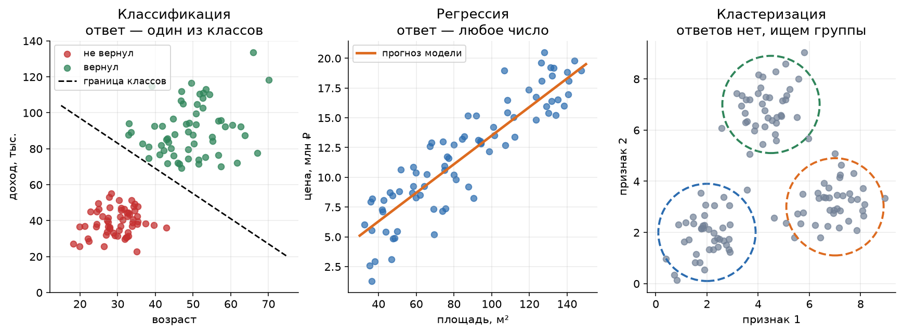

### Классификация

**Целевая переменная принимает конечное число заранее известных значений (классов).**

- **Бинарная** (2 класса): вернёт / не вернёт кредит; уйдёт клиент или нет (отток); болен / здоров.
- **Многоклассовая**: какой болезнью болен пациент (из списка); что на фото — кошка, самолёт, человек… (датасет ImageNet — 1000 классов).

> ❓ *«Но ведь модель скоринга выдаёт вероятность возврата 0.8 — это непрерывное число, значит регрессия?»*
> Нет. Умение выдавать вероятность — это **свойство** почти любого классификатора, а не тип задачи. Тип задачи определяется тем, **что такое $y$**: в скоринге $y \in \{0, 1\}$ → классификация.

### Регрессия

**Целевая переменная — число, может принимать бесконечно много значений.**

Цена квартиры, прибыль компании, температура завтра, время доставки, рост ребёнка, рост ВВП.

### Пограничный случай: оценка за курс 1–10

`⏱ 0:46`

Значений всего 10 — вроде классификация. Но лектор советует **регрессию**, и вот почему:

- Оценки **упорядочены**: 6 > 5, а 9 очень далеко от 3.
- Классификатор считает классы **никак не связанными** между собой, как «кошка» и «самолёт». Он может быть одинаково уверен в «9» и в «3» — для него это просто два разных ярлыка.
- Регрессия «знает», что это числа на одной оси. Предсказываем 7.89 → округляем до 8.

**Правило:** если у классов есть естественный порядок (оценки, возраст, рейтинг) — скорее регрессия. Если порядка нет (виды животных) — классификация.

### Кластеризация

`⏱ 0:50`

**Целевой переменной нет.** Хотим разбить объекты на группы (кластеры) так, чтобы внутри группы объекты были похожи, а между группами — нет.

Примеры: сгруппировать новости по похожести; сегментировать пользователей сервиса.

Отличие от классификации: в классификации **список классов фиксирован заранее** («мужчины / женщины» — это классификация, целевая переменная — пол). В кластеризации мы заранее не знаем, какие группы получатся.

### Другие задачи

Ранжирование (порядок выдачи в поисковике), рекомендации, снижение размерности, поиск аномалий, генерация (картинки, текст, звук), визуализация данных. Многие из них в итоге сводятся к классификации или регрессии.

### Большое деление

| | Есть целевая переменная? | Примеры |
|---|---|---|
| **Обучение с учителем** (supervised) | Да — «учитель» показывает правильные ответы | Классификация, регрессия, ранжирование |
| **Обучение без учителя** (unsupervised) | Нет | Кластеризация, снижение размерности |

---

## 5. Модель = формула. Линейная регрессия

`⏱ 0:56`

> **Главная мысль: в ML нет магии. Любая модель — это математическая формула с неизвестными параметрами.** Простая (линейная регрессия) или очень сложная (нейросеть с триллионами параметров), но формула.

### Задача

Предсказать цену дома $y$ по площади $x_1$ и числу комнат $x_2$. Это **регрессия** (цена — непрерывное число).

### Шаг 1. Выбираем класс модели

Есть много семейств: линейные модели, деревья, случайные леса, бустинги, нейросети. Выбираем семейство — тем самым выбираем **вид формулы**. Самое простое — **линейная регрессия**:

$$a(x) = w_0 + w_1 x_1 + w_2 x_2$$

Читается так: «прогноз = константа + вес₁ × площадь + вес₂ × комнаты».

- $a(x)$ — прогноз модели (*a* от *algorithm*) для объекта $x$.
- $x_1, x_2$ — признаки дома. **Известны.**
- $w_1, w_2$ — **веса** признаков. Насколько сильно признак влияет на цену. **Неизвестны.**
- $w_0$ — **свободный член, смещение, bias.** Значение прогноза, когда все признаки равны нулю. **Неизвестен.** Без него прямая обязана проходить через начало координат — это ненужное ограничение.

В общем случае для $d$ признаков:

$$a(x) = w_0 + w_1 x_1 + w_2 x_2 + \dots + w_d x_d = w_0 + \sum_{j=1}^{d} w_j x_j$$

**Число параметров = $d + 1$** (по весу на каждый признак + bias). Для 10 признаков — 11 параметров. Очень мало по сравнению с нейросетями.

### Что эта формула означает геометрически

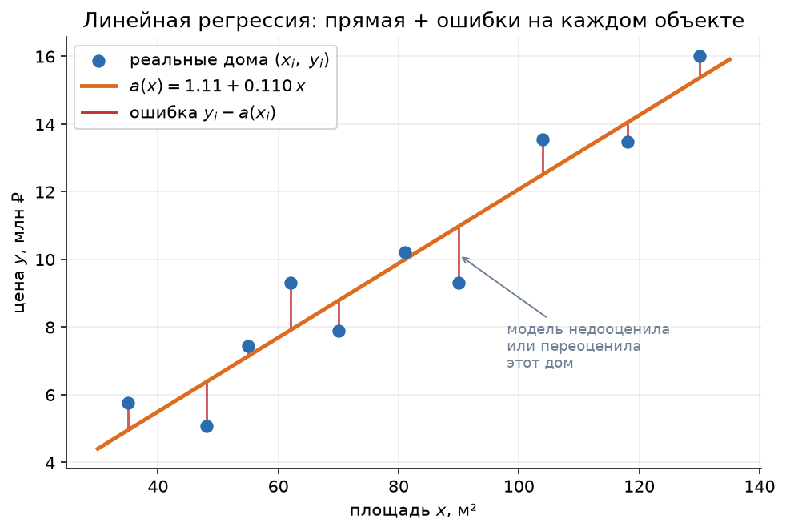

- 1 признак → формула задаёт **прямую** на плоскости.
- 2 признака → **плоскость** в 3D.
- $d$ признаков → **гиперплоскость** в $(d+1)$-мерном пространстве.

Модель **предполагает, что цена зависит от признаков линейно** — отсюда название. Красные отрезки на картинке — ошибки модели на каждом доме. Хорошая модель — та, у которой эти отрезки в сумме «маленькие». Осталось договориться, как это измерить.

### Как читать веса

- $w_j > 0$: признак растёт → прогноз растёт (больше площадь → дороже).
- $w_j < 0$: признак растёт → прогноз падает (дальше от метро → дешевле).
- Например, $w_1 = 0.11$ (млн ₽ за м²) означает: «+1 м² при прочих равных → +110 тыс. ₽ к цене».

---

## 6. Функция потерь и что такое «обучение»

`⏱ 1:03`

### Как измерить, насколько модель ошибается

Для одного дома ошибка = **правильный ответ − прогноз**: $y_i - a(x_i)$.
Дом стоит 10 млн, модель сказала 9 → ошибка +1 млн.

Хотим одно число на всю выборку → **усредняем**. Но не сами ошибки, а их **квадраты**:

$$\boxed{\ \text{MSE}(w) = \frac{1}{\ell}\sum_{i=1}^{\ell}\big(y_i - a(x_i)\big)^2\ }$$

**MSE** — mean squared error, среднеквадратичная ошибка. $\ell$ — число объектов.

### Зачем квадрат?

`⏱ 1:04`

Ошибки бывают **разных знаков**: недооценили (+) или переоценили (−). Если просто усреднить, они **взаимно уничтожатся**:

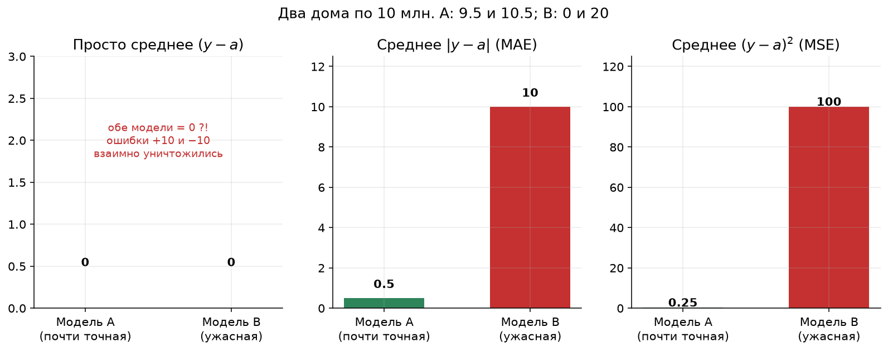

Модель B ошиблась на 10 млн в каждую сторону — ужасная модель. Но «просто среднее» ошибок у неё 0, как у идеальной. Это недопустимо: формула качества не должна давать маленькую ошибку плохой модели.

Значит, знак нужно убрать. Два способа:
- **модуль** $|y - a|$ → MAE (mean absolute error) — тоже рабочий вариант;
- **квадрат** $(y - a)^2$ → MSE — самый распространённый.

> Это ответ «уровня джуна». Лектор обещала на следующей неделе ответы «уровня мидла» — почему именно квадрат, а не модуль. Спойлер: квадрат гладкий (удобно дифференцировать) и связан со статистикой (нормальным распределением ошибок).

### Где здесь веса?

`⏱ 1:07`

В формуле MSE вроде нет $w$, но они «спрятаны» внутри $a(x_i)$. Подставим линейную модель:

$$\text{MSE}(w_0, w_1, w_2) = \frac{1}{\ell}\sum_{i=1}^{\ell}\big(y_i - w_0 - w_1 x_{i1} - w_2 x_{i2}\big)^2$$

Все $x$ и $y$ известны (это наши данные). **Неизвестны только веса.** Значит, MSE — это **функция от весов**: подставляешь разные $w$ — получаешь разную ошибку.

### Обучение = поиск весов с минимальной ошибкой

$$\boxed{\ w^{*} = \arg\min_{w}\ \text{MSE}(w)\ }$$

«Найти такие веса $w^*$, при которых функция потерь минимальна».

**Это главная мысль лекции.** Красивая фраза «модель находит закономерности в данных» на языке математики означает ровно это: *подбор чисел $w$, при которых ошибка на обучающих данных минимальна.*

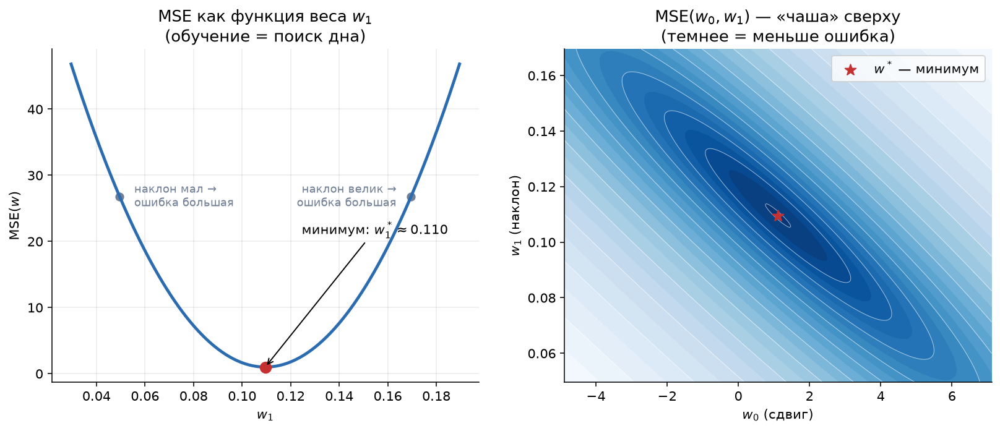

Слева — как меняется MSE, если крутить только наклон $w_1$: слишком маленький наклон → большая ошибка, слишком большой → тоже, где-то посередине **дно**. Справа — то же самое для двух весов сразу: функция потерь — это «чаша», и обучение — это поиск её дна.

**Как именно компьютер находит дно** (формулой или градиентным спуском) — тема следующих лекций.

### ✍️ Считаем руками

Три дома: площадь $x$ (в сотнях м²) и цена $y$ (млн ₽):

| дом | $x$ | $y$ |
|---|---|---|
| 1 | 1 | 2 |
| 2 | 2 | 3 |
| 3 | 3 | 5 |

**Попытка 1 — наугад:** $w_0 = 0,\ w_1 = 2$, т.е. $a(x) = 2x$.

| дом | $y$ | $a(x)$ | $y - a$ | $(y-a)^2$ |
|---|---|---|---|---|
| 1 | 2 | 2 | 0 | 0 |
| 2 | 3 | 4 | −1 | 1 |
| 3 | 5 | 6 | −1 | 1 |

$$\text{MSE} = \frac{0 + 1 + 1}{3} \approx 0.667$$

**Попытка 2 — оптимальные веса** (их найдёт компьютер): $w_0 = \tfrac{1}{3},\ w_1 = 1.5$, т.е. $a(x) = 0.333 + 1.5x$.

| дом | $y$ | $a(x)$ | $y - a$ | $(y-a)^2$ |
|---|---|---|---|---|
| 1 | 2 | 1.833 | +0.167 | 0.028 |
| 2 | 3 | 3.333 | −0.333 | 0.111 |
| 3 | 5 | 4.833 | +0.167 | 0.028 |

$$\text{MSE} = \frac{0.028 + 0.111 + 0.028}{3} \approx 0.056$$

Ошибка упала в 12 раз. Никакие другие $w_0, w_1$ не дадут MSE меньше 0.056 — это и есть дно «чаши». **Обучение = компьютер перебирает/вычисляет веса, пока не найдёт это дно.**

<details><summary>Откуда взялись 1.5 и 1/3? (забегая вперёд)</summary>

Для одного признака есть готовая формула (метод наименьших квадратов):

$$w_1 = \frac{\sum_i (x_i - \bar x)(y_i - \bar y)}{\sum_i (x_i - \bar x)^2}, \qquad w_0 = \bar y - w_1 \bar x$$

Здесь $\bar x = 2,\ \bar y = 10/3$:

$$w_1 = \frac{(-1)(-\tfrac43) + 0\cdot(-\tfrac13) + 1\cdot\tfrac53}{1 + 0 + 1} = \frac{3}{2} = 1.5, \qquad w_0 = \tfrac{10}{3} - 1.5\cdot 2 = \tfrac13$$

Подробно разберём на лекции про линейную регрессию.
</details>

### Терминология

**Функция потерь = функционал ошибки = loss** — одно и то же (есть тонкости, но лектор их не различает). В deep learning всегда говорят *loss*.

---

## 7. Метрика качества ≠ функция потерь

`⏱ 1:11`

После обучения веса зафиксированы. Теперь нужно понять: **модель хорошая или нет?** Для этого используют **другую** функцию — **метрику качества**.

| | Функция потерь (loss) | Метрика качества |
|---|---|---|
| **Когда** | Во время обучения | После обучения, при оценке |
| **Для кого** | Для компьютера (оптимизатора) | Для человека и бизнеса |
| **Требования** | Удобна для оптимизации: гладкая, желательно с одним минимумом | Понятна, интерпретируема, отражает бизнес-цель. Формально — любая |
| **Пример** | MSE | RMSE, MAE, accuracy, своя метрика |

### Почему MSE плохая метрика: пример с миллионом

`⏱ 1:13`

Модель предсказывает цену дома в рублях, MSE = 1 000 000. Хорошо это или плохо?

Интуитивно «миллион ошибки — ужас». Но MSE измеряется **в рублях в квадрате**! Чтобы вернуться к рублям, извлекаем корень:

$$\text{RMSE} = \sqrt{\text{MSE}} = \sqrt{1\,000\,000} = 1000 \text{ ₽}$$

Модель ошибается в среднем на тысячу рублей при цене дома в миллионы — **отличная модель**. MSE не сохраняет единицы измерения, поэтому как метрика неудобна. **RMSE** хотя бы в тех же единицах, что и цена.

### Метрика для классификации: accuracy

$$\text{accuracy} = \frac{\text{число верных ответов}}{\text{число всех объектов}}$$

100 тестовых клиентов, модель угадала у 80 → accuracy = 0.8. (Позже в курсе узнаем, почему accuracy часто обманывает — например, при редком классе.)

### Почему не оптимизировать сразу метрику?

`⏱ 1:17` — хороший вопрос для собеседования.

Метрика может быть **любой** формулой, а оптимизатору нужны «удобные» функции. Например, accuracy — **ступенчатая**: если чуть-чуть сдвинуть веса, число верных ответов обычно не меняется вовсе → непонятно, в какую сторону двигаться. MSE же гладкая «чаша» — у неё в каждой точке понятно, где «вниз». Поэтому обучаем на удобном loss, а оцениваем по понятной метрике.

---

## 8. Train / test: честная проверка

`⏱ 1:19`

Если проверять модель **на тех же данных, на которых она обучалась**, оценка будет нечестной: мы уже *показали* модели правильные ответы, странно было бы ей ошибаться. Это как дать студенту на экзамене те же задачи, что разбирали на семинаре, — проверяешь память, а не понимание.

Поэтому все размеченные данные делят на две части:

```
[ ████████████████████████  train (70–80%) ][ ██████  test (20–30%) ]
         подбираем веса                       считаем метрику
```

- **train** — на нём модель обучается (подбирает веса);
- **test** — модель его **ни разу не видела**; на нём делаем прогноз и считаем метрику.

Так мы имитируем реальную жизнь: в проде к модели приходят **новые** объекты.

Позже появится третья часть — **validation** (train / val / test) — для подбора настроек модели.

---

## 9. Полный цикл ML-проекта

`⏱ 1:21`

Многим кажется, что ML — это `model.fit()`. На деле обучение модели — **один кубик** из многих:

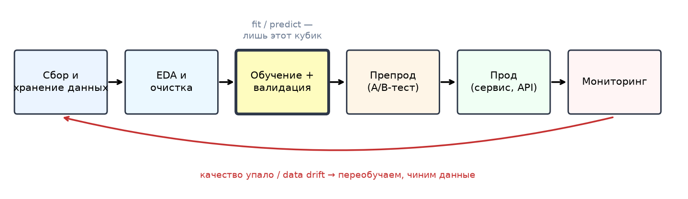

1. **Сбор и хранение данных.** Данные приходят из баз, Excel, API приложений. Их нужно собрать, проверить качество, регулярно обновлять, складывать в единое хранилище. Сложная инженерная работа.
2. **EDA и очистка** (см. семинар ниже).
3. **Обучение + валидация.** Подбор весов и оценка на отложенной выборке.
4. **Препрод: A/B-тест на реальных пользователях.** Хорошие offline-метрики **не гарантируют** успеха. Типичная история в рекомендательных системах: метрики идеальные, а пользователи по новым рекомендациям ничего не покупают. Причины: поведение людей изменилось с момента сбора данных; метрика не отражала реальную цель; data drift.
5. **Прод.** Модель оборачивают в сервис, API, бота — встраивают в бизнес-процесс.
6. **Мониторинг.** Качество модели **со временем деградирует** (пользователи привыкают к рекомендациям, меняется мир). Нужны графики ML-метрик, технических метрик и бизнес-метрик. Если что-то сломалось — переобучаем модель или чиним данные (красная стрелка назад).

> 💡 Для AI-инженера это, пожалуй, самый практичный слайд лекции. В домашках курса тоже будут «кубики вокруг fit/predict»: обернуть модель в сервис, сделать дашборд (Streamlit), настроить мониторинг.

---

## 10. Семинар: EDA шаг за шагом

`⏱ 1:35` · ноутбук `Week1_Intro_EDA/EDA_LinReg_Base.ipynb`

**EDA (Exploratory Data Analysis, разведочный анализ данных)** — изучаем данные *до* обучения модели.

**Датасет:** diabetes из sklearn. 442 пациента, 10 числовых признаков (возраст, пол, индекс массы тела `bmi`, давление `bp`, шесть показателей крови `s1`–`s6`). Целевая переменная — насколько прогрессировала болезнь через год. **Задача регрессии.** Для семинара датасет специально «испортили»: добавили пропуски и ошибки.

**Инструменты:** `pandas` (таблицы), `numpy` (вычисления), `matplotlib`/`seaborn` (графики), **`scikit-learn`** (`sklearn`) — главная библиотека классического ML в курсе.

```python
df = pd.read_csv(url)
y = df["target"]                 # вектор ответов
X = df.drop(columns="target")    # матрица объект-признак
X.shape                          # (442, 10): 442 пациента, 10 признаков
X.describe()                     # count, mean, std, min, max по каждому столбцу
```

### Шаг 1. `describe()` — первый взгляд

`⏱ 1:40`

Сразу видно:
- **пропуски**: `count` в некоторых столбцах меньше 442 → есть `NaN`;
- **явные ошибки**: возраст **510 лет**, индекс массы тела 314, **отрицательное давление**;
- **разные масштабы**: возраст — десятки, `s1` — сотни, пол — 1 или 2.

### Шаг 2. Пропуски: удалять или заполнять?

`⏱ 1:42`

**Удалять строки с пропусками — плохая идея**, по двум причинам:
1. Данных мало (442 — это мало), каждый объект на счету.
2. **В проде пропуски тоже будут.** Придёт клиент, у которого не заполнено «число детей», — модель обязана выдать ответ. Значит, нужно уметь обрабатывать пропуски, а не выкидывать их.

Удалять можно, только если данных очень много, а пропусков совсем чуть-чуть.

**Заполнять — чем?** Средним или медианой по столбцу. **Медиана надёжнее.**

### Шаг 3. Сначала ошибки → NaN, потом заполнение

`⏱ 1:45`

Порядок важен:

```
1. Найти явные ошибки (здравым смыслом)
2. Заменить ошибки на NaN
3. Заполнить все NaN медианой
```

**Почему не заполнять сразу?** Потому что ошибочные значения сильно **искажают среднее**:

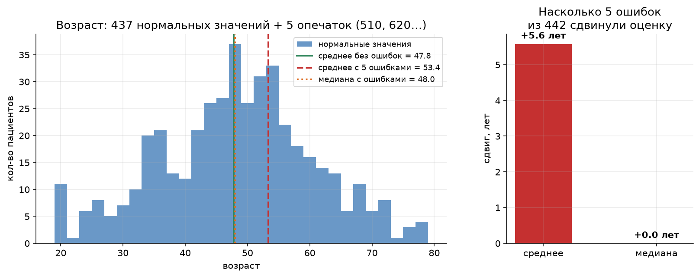

Пять опечаток (510, 620…) из 442 значений сдвинули среднее возраста почти на 6 лет, а медиана не сдвинулась вообще. На семинаре похожий эффект: среднее `bmi` было 27, после удаления 5 ошибок стало 26.4.

✍️ **Руками:** возрасты 30, 40, 50, 60, **510** (опечатка).
- Среднее $= \frac{30+40+50+60+510}{5} = 138$ — бессмыслица.
- Медиана (середина отсортированного ряда) $= 50$ — разумно.

Медиана смотрит только на «середину» и не обращает внимания на то, *насколько* далеко крайние значения. Поэтому она устойчива к выбросам.

**Как искать ошибки?** Здравым смыслом: для каждого признака задать разумный диапазон. Возраст не может быть меньше 0 и вряд ли больше 120 (можно взять 150, не страшно). Давление не бывает отрицательным. Всё за пределами разумного — ошибка.

> Удалять строки с ошибками тоже плохо — по той же причине: в проде ошибки ввода тоже будут.

### Шаг 4. Боксплот и «выбросы», которые не надо трогать

`⏱ 2:11` — лектор очень настаивала на этом пункте.

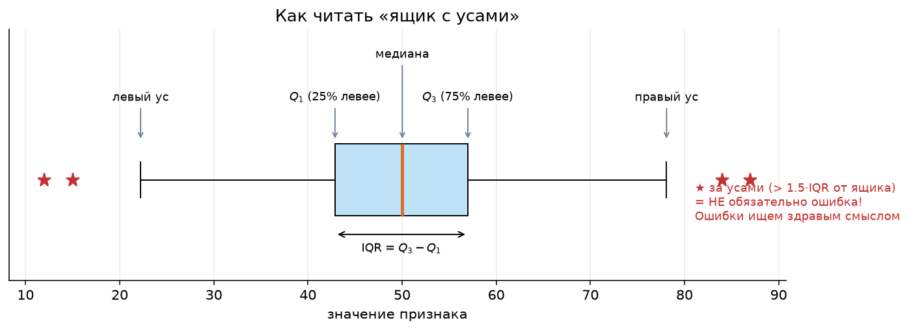

**Как читать «ящик с усами» (boxplot):**
- линия внутри ящика — **медиана**;
- края ящика — квартили $Q_1$ (25% значений левее) и $Q_3$ (75% левее). В ящике — средняя половина данных;
- **IQR** $= Q_3 - Q_1$ — ширина ящика (интерквартильный размах);
- усы: $[\,Q_1 - 1.5\cdot\text{IQR},\ \ Q_3 + 1.5\cdot\text{IQR}\,]$ (точнее, до самой дальней точки внутри этих границ);
- точки/звёздочки за усами — то, что боксплот *помечает* как выбросы.

**После того как явные ошибки обработаны, звёздочки за усами НЕ трогаем:**

- ❌ не удаляем;
- ❌ не обрезаем (clip) до уса;
- ❌ не обрезаем по квантилям.

**Почему?** Правый ус = 80 лет, пришёл клиент, которому 81. Он что, аномалия? Нет, обычный человек. Если удалить такие объекты, датасет станет **искусственно чище реальности**, и в проде модель будет работать хуже. Если обрезать 81 до 80 — теряем информацию об объекте.

**Однофакторный анализ** (смотрим на один признак) может показать только **ошибку** (возраст 510). Чтобы объявить объект настоящей аномалией, нужно гораздо больше условий. Поиск аномалий будет отдельной темой в конце курса.

> Правило 1.5·IQR придумано из свойств нормального распределения: для него за усами лежит лишь ≈0.7% данных. Но реальные признаки часто не нормальные, так что «за усом» ≠ «аномалия».

### Шаг 5. Масштабирование признаков

`⏱ 1:50`

Признаки в разных масштабах (возраст ~50, `s1` ~190, пол 1–2). Для многих моделей это мешает обучению (особенно нейросетям и всему, что учится градиентным спуском) и мешает сравнивать веса.

**Два основных способа:**

$$\text{StandardScaler (стандартизация):}\quad x' = \frac{x - \mu}{\sigma}$$

$\mu$ — среднее столбца, $\sigma$ — стандартное отклонение. После: среднее 0, стандартное отклонение 1, значения обычно в $[-3, 3]$.

$$\text{MinMaxScaler:}\quad x' = \frac{x - x_{\min}}{x_{\max} - x_{\min}}$$

После: все значения в $[0, 1]$.

✍️ **Руками (StandardScaler):** возрасты 20, 40, 60.
$\mu = 40$, $\sigma = \sqrt{\frac{(20-40)^2 + 0 + (60-40)^2}{3}} = \sqrt{\frac{800}{3}} \approx 16.3$.
$x' = \frac{20-40}{16.3},\ \frac{0}{16.3},\ \frac{20}{16.3} \approx -1.22,\ 0,\ 1.22$.

```python
from sklearn.preprocessing import StandardScaler
X_scaled = StandardScaler().fit_transform(X)
```

sklearn не масштабирует данные автоматически: выбор способа зависит от задачи (например, иногда нужны только неотрицательные значения).

#### Что масштабирование делает с линейной регрессией

`⏱ 1:54`

1. **Качество не меняется.** Это линейное преобразование: никакой информации не теряется, модель просто подстроит веса. (Верно для обычной регрессии; с регуляризацией, которая появится позже, это уже не так.)
2. **Зато веса становятся сравнимыми.** До масштабирования в весе «сидит» масштаб признака. После — $|w_j|$ показывает **важность** признака.

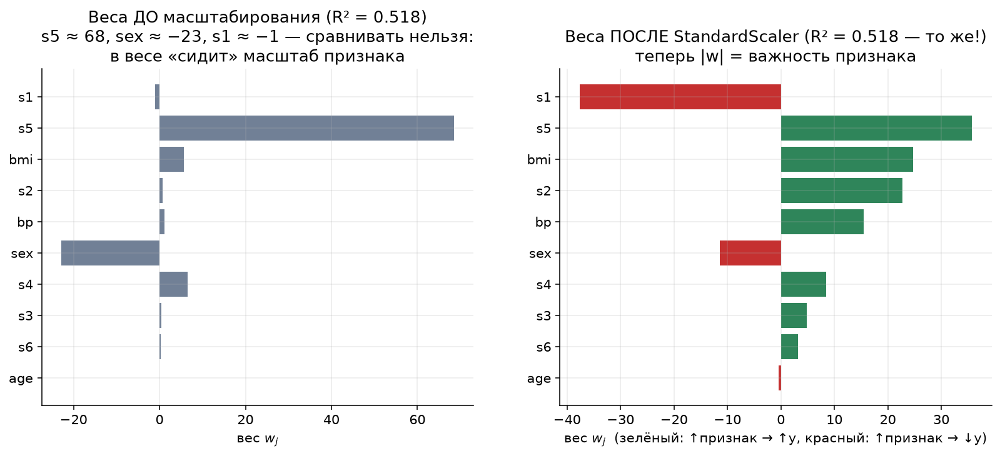

На реальном diabetes видно (R² одинаковый — 0.518):
- **До:** `s1` ≈ −1 (кажется неважным), `s5` ≈ 68 (кажется огромным). Но `s1` измеряется в сотнях, а `s5` — в единицах, отсюда и разница.
- **После:** `s1` = −37.7 — **самый влиятельный** признак! `s5` = 35.7, `bmi` = 24.7. Возраст ≈ 0 — почти не влияет.

**Знак веса:** положительный — признак растёт, $y$ растёт (больше зарплата → выше счастье); отрицательный — признак растёт, $y$ падает (больше часов работы → ниже счастье). Большой по модулю отрицательный вес = признак важен, но влияет «вниз».

> ⚠️ Подвох, который виден на графике: у `s1` вес большой **отрицательный**, у `s2` большой **положительный**, хотя оба положительно связаны с target. Это потому что `s1` и `s2` почти дублируют друг друга (корреляция 0.9): модель «делит» между ними вклад причудливым образом. Это называется **мультиколлинеарность**, будем разбирать дальше. Вывод: интерпретировать веса нужно осторожно.

(У лектора на испорченных и заполненных данных самым важным вышел `s5` — данные немного другие, отсюда разница.)

### Шаг 6. Смотрим на целевую переменную

`⏱ 2:02`

- **Пропуски в $y$ не заполняем** — такие объекты удаляем (на чём учиться, если ответа нет?).
- Строим **гистограмму** $y$. Ищем:
  - выбросы и странности;
  - **бимодальность** (два «горба»). Пример: цены квартир — основной горб + маленький горб элитного жилья справа. Эту информацию нужно как-то передать модели;
  - сильную **скошенность** — модели с ней сложнее.

Здесь у diabetes распределение «терпимое», работать можно.

### Шаг 7. Корреляции

`⏱ 2:05`

**Корреляция** — мера связи двух величин, от −1 до 1. Около 0 — нет (линейной!) связи; ближе к ±1 — сильная связь.

```python
df.corr()   # матрица корреляций всех столбцов
```

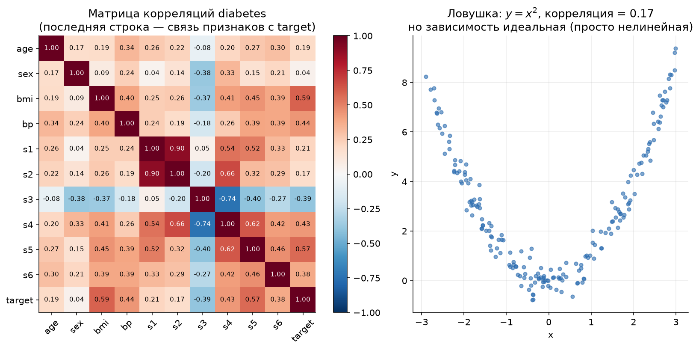

**Что смотреть:**
1. **Строку target** — как признаки связаны с ответом. У diabetes: `bmi` 0.59, `s5` 0.57, `bp` 0.44 — заметные связи → есть основания думать, что ML сработает. Если бы вся строка была около нуля, лектор говорит, что ML бы не помог.
2. **Корреляции признаков между собой.** `s1` и `s2`: 0.90 — почти про одно и то же. Возможно, один из них лишний (но это нужно проверять экспериментом, а не удалять сразу).

**Нельзя выкидывать признак только из-за нулевой корреляции с target!** Признак может быть бесполезен *сам по себе*, но важен *в комбинации* с другими. Пример лектора: «цвет животного серый» почти ничего не говорит. «Вес 20 тонн» — уже что-то. А «серое + 20 тонн» — почти наверняка слон или кит.

> ⚠️ **Уточнение к лекции.** Коэффициент корреляции (Пирсона) ловит только **линейную** связь. Правая картинка: $y = x^2$ — зависимость идеальная, а корреляция ≈ 0. Поэтому «корреляция ≈ 0» ≠ «связи нет». Линейная модель такую зависимость не увидит, а дерево или бустинг — увидят.

### Зачем вообще EDA

`⏱ 2:04`

1. Понять, **есть ли в данных зависимости** с целевой переменной. Если нет — ML, скорее всего, не поможет, и лучше узнать это **до** недели «танцев с бубном» вокруг модели.
2. Найти и **почистить грязь**: пропуски, ошибки, дубликаты.
3. **Главное — сделать текстовые выводы.** Графики и числа сами по себе не ценны; ценны инсайты из них. После каждого графика — абзац «что я отсюда понял». Это особо важно в домашках и проекте.

**Базовый чек-лист EDA:** пропуски → ошибки → масштабы → целевая переменная → корреляции → дубликаты.

---

## 11. Семинар: обучение, кросс-валидация, дубликаты

### Обучение в sklearn

`⏱ 2:22`

```python
from sklearn.model_selection import train_test_split
from sklearn.linear_model import LinearRegression
from sklearn.metrics import mean_squared_error, mean_absolute_error, r2_score

X_train, X_test, y_train, y_test = train_test_split(
    X, y, test_size=0.25, random_state=42
)

model = LinearRegression()
model.fit(X_train, y_train)        # обучение = поиск w*, минимизирующих MSE
y_pred = model.predict(X_test)     # прогноз на НЕвиденных данных

mean_squared_error(y_test, y_pred)
r2_score(y_test, y_pred)
model.coef_, model.intercept_      # веса w_1..w_d и bias w_0
```

- **`test_size`** — доля теста. Обычно 20–30%: в train побольше (модели нужно на чём учиться), но и test не слишком маленький (иначе оценке нельзя доверять).
- **`random_state`** — фиксирует случайность разбиения. Без него при каждом запуске в test попадают разные объекты → результаты **невоспроизводимы**. Ставим любое число (42 — традиция) и **больше не трогаем**. Подбирать seed, при котором метрика лучше, — это самообман («подгонка под сид»).
- Полезно проверить, что $y$ в train и test распределён похоже (сравнить гистограммы).

**Метрики регрессии** (подробно — в следующих лекциях): MSE, MAE (средний модуль ошибки), R² (доля объяснённой дисперсии; 1 — идеально, 0 — не лучше константы). Можно **придумать свою метрику** под бизнес — например, максимальную ошибку, если важно не ошибиться сильно ни разу. Это будет в одной из домашек.

### Проблема: метрика зависит от разбиения

`⏱ 2:27`

Лектор убрала `random_state` и перезапускала: R² = 0.43 → 0.51 → 0.48. Одна и та же модель, одни и те же данные — разные числа. Мы повторили эксперимент 300 раз:

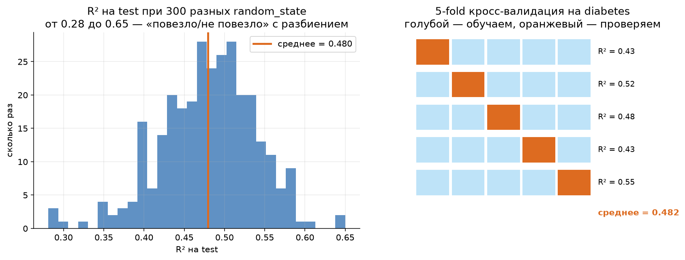

R² гуляет от 0.28 до 0.65 в зависимости от того, какие пациенты случайно попали в test. Одно разбиение может «повезти» (тест без сложных объектов) или «не повезти». Нам нужно **среднее** поведение модели.

### Кросс-валидация (K-fold)

`⏱ 2:28`

1. Делим данные на $K$ равных частей (фолдов), обычно $K = 3$–$5$.
2. $K$ раз: обучаемся на $K-1$ частях, проверяем на оставшейся. Каждая часть ровно один раз побывает в роли теста.
3. **Усредняем** $K$ метрик.

$$\text{CV-оценка} = \frac{1}{K}\sum_{k=1}^{K} \text{метрика}_k$$

На diabetes (справа): R² по фолдам 0.43 / 0.52 / 0.48 / 0.43 / 0.55, среднее 0.482 — практически совпадает со средним по 300 случайным разбиениям. Одна кросс-валидация дала то же, что 300 экспериментов.

```python
from sklearn.model_selection import cross_val_score, cross_validate

scores = cross_val_score(LinearRegression(), X, y, cv=5, scoring="r2")
scores.mean()
```

Для MSE в sklearn пишут `scoring="neg_mean_squared_error"` — sklearn всегда *максимизирует* скор, поэтому ошибки отдаёт со знаком минус. Отсюда «минус уберём» у лектора.

**Важно понимать:**
- Кросс-валидация — **способ оценки качества, а не обучения**. $K$ промежуточных моделей потом выбрасываются.
- Если оценка устраивает → обучаем финальную модель **на всём train**.
- Если не устраивает → меняем модель или её настройки (гиперпараметры) и снова оцениваем.
- Для временных рядов есть специальная кросс-валидация (нельзя «заглядывать в будущее») — будет позже.
- Когда разбиение на две части, слова «валидация» и «тест» часто взаимозаменяемы.

### Дубликаты

`⏱ 2:33`

Полностью одинаковые строки (случайно задублировались в Excel или БД). Казалось бы, безобидно. Но **дубликат = объект с увеличенным весом**: в MSE его ошибка считается много раз, и модель «тянется» к нему.

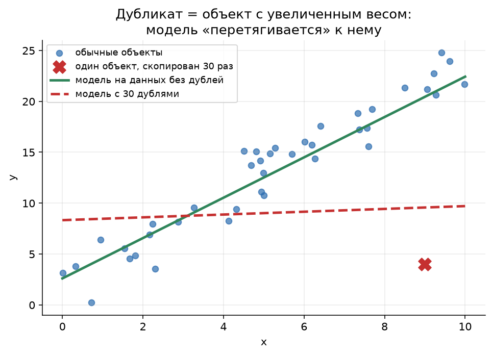

На семинаре одну строку скопировали 30 раз (из ~450) → MSE выросла с 2893 до 3580. Если задублирован неудачный объект, модель заметно портится.

**Полные дубликаты удаляем.**

**Но!** Два дома с одинаковой площадью и числом комнат и **разной ценой** — **не дубликаты**. Это нормальная ситуация: объекты с одинаковым признаковым описанием могут иметь разные ответы (признаки не описывают объект полностью). Такие строки оставляем.

### Вопросы из чата в конце

`⏱ 2:38`

- **Как выбрать модель?** На практике — перебрать несколько и посмотреть, какая работает лучше (по кросс-валидации).
- **EDA для картинок / текстов?** Там классического EDA почти нет. Для картинок: баланс классов, странные объекты, нормализация. Для текстов: мусорные символы, распределение слов.
- **CatBoost** будет примерно на 25-м занятии.

---

## 12. Итог в одной таблице

| Тема | Суть одной фразой |
|---|---|
| ML | Модель сама подбирает правила по данным с ответами |
| Когда не нужен | Есть формула / нет данных / нужна 100% точность / нет зависимости |
| Объект, признаки, target | Что прогнозируем / чем описываем / что предсказываем |
| $X$ и $y$ | Матрица $\ell \times d$ и вектор длины $\ell$ |
| Классификация / регрессия | Конечный набор классов / число. Есть порядок → регрессия |
| Кластеризация | Нет $y$, группируем похожие |
| Линейная регрессия | $a(x) = w_0 + \sum_j w_j x_j$, параметров $d+1$ |
| MSE | $\frac{1}{\ell}\sum (y_i - a(x_i))^2$; квадрат — чтобы ошибки не сокращались |
| Обучение | $w^* = \arg\min_w \text{MSE}(w)$ — поиск дна «чаши» |
| Loss vs метрика | Loss удобен оптимизатору, метрика понятна человеку |
| RMSE | $\sqrt{\text{MSE}}$ — возвращает единицы измерения |
| Train / test | Оцениваем только на невиденных данных |
| Кросс-валидация | $K$ разбиений → среднее; способ оценки, не обучения |
| `random_state` | Воспроизводимость; не подгонять |
| Пропуски | Не удалять, заполнять медианой (после обработки ошибок) |
| Ошибки в данных | Здравый смысл → NaN → медиана |
| Точки за усами | Не трогать |
| Масштабирование | На качество линрега не влияет, но делает веса сравнимыми |
| Корреляция | Только линейная связь; ≈0 не повод выкидывать признак |
| Дубликаты | Полные удаляем; одинаковые $X$ с разным $y$ — оставляем |
| Цикл проекта | Данные → EDA → модель → A/B → прод → мониторинг → … |
