# Лекция 2 — расширенный конспект

**Часть 1: продвинутый EDA (корреляции для любых признаков). Часть 2: линейная регрессия — функции потерь, признаки, аналитическое решение**

> Этот файл можно читать **вместо просмотра лекции**. Краткая версия с картой и самопроверкой — [lecture_02.md](lecture_02.md).
> `⏱ 1:42` — где смотреть в записи. Графики строит [scripts/lecture_02_plots.py](scripts/lecture_02_plots.py) на **реальном датасете** из семинара (`data/CustomerChurn.csv`).

## Содержание

**Часть 1. Advanced EDA**
1. [Датасет и первичная чистка](#1-датасет-и-первичная-чистка)
2. [EDA в одну строчку: автоотчёты](#2-eda-в-одну-строчку-автоотчёты)
3. [Признаки в разрезе целевой переменной](#3-признаки-в-разрезе-целевой-переменной)
4. [Бины, пары признаков и feature engineering](#4-бины-пары-признаков-и-feature-engineering)
5. [Корреляция числовых признаков: Пирсон, Спирмен, Кендалл](#5-корреляция-числовых-признаков-пирсон-спирмен-кендалл)
6. [Связь категориальных признаков: χ², V Крамера, φK](#6-связь-категориальных-признаков-χ²-v-крамера-φk)
7. [Корреляция ≠ причинность. Что сдавать как EDA](#7-корреляция--причинность-что-сдавать-как-eda)

**Часть 2. Линейная регрессия**

8. [Векторная запись](#8-векторная-запись)
9. [MSE vs MAE: выбросы](#9-mse-vs-mae-выбросы)
10. [Константный прогноз: почему MSE → среднее, MAE → медиана](#10-константный-прогноз-почему-mse--среднее-mae--медиана)
11. [Квантильная функция потерь и функция Хубера](#11-квантильная-функция-потерь-и-функция-хубера)
12. [Категориальные и немонотонные признаки](#12-категориальные-и-немонотонные-признаки)
13. [Почему регрессия «линейная»](#13-почему-регрессия-линейная)
14. [Аналитическое решение](#14-аналитическое-решение)
15. [Итог в одной таблице](#15-итог-в-одной-таблице)

---

# Часть 1. Advanced EDA

> Лектор пометила эту часть как **Pro** — «полезное, но не обязательное». Однако корреляции (разделы 5–7) пригодятся всем.

## 1. Датасет и первичная чистка

`⏱ 0:05`

**Telco Customer Churn** — клиенты мобильного оператора, 7043 строки. Признаки: пол, пенсионер ли (`SeniorCitizen`), есть ли партнёр и иждивенцы, сколько месяцев с компанией (`tenure`), подключённые услуги (телефон, интернет DSL / оптоволокно, онлайн-защита, ТВ…), тип контракта, способ оплаты, ежемесячный платёж (`MonthlyCharges`), сумма за всё время (`TotalCharges`).

**Целевая переменная — `Churn`** (ушёл клиент или нет). Сегодня модель не строим — только исследуем, *чем ушедшие отличаются от оставшихся*.

### Что за тип у `customerID`?

Формально это признак (колонка же есть). По типу — категориальный или строковый:
- **категориальный** — конечный набор заранее известных значений;
- **строковый (текстовый)** — значение может быть любой строкой.

Смысла для прогноза в ID нет (все уникальны), поэтому его удаляют. Но тип понимать полезно: если с колонкой придётся работать, от типа зависит, как её кодировать.

### `TotalCharges` — число, записанное как строка

`df.dtypes` показывает: `MonthlyCharges` — `float`, а `TotalCharges` — `object` (строка). Странно: это явно числа. Попытка `astype(float)` падает: в колонке есть **пустые строки `" "`** — по сути пропуски.

Чем заполнить? Подумаем по смыслу: пусто в «сколько всего заплатил» → **0**. Проверка на данных подтверждает догадку: все 11 таких клиентов имеют `tenure = 0`, то есть только что подключились.

```python
df["TotalCharges"] = pd.to_numeric(df["TotalCharges"].replace(" ", "0"))
```

> 💡 Попутно: тип `object` можно перевести в `category` — pandas будет хранить категории компактнее и тратить меньше памяти.

---

## 2. EDA в одну строчку: автоотчёты

`⏱ 0:13`

Базовый EDA (пропуски, дубликаты, распределения, корреляции) не обязательно писать руками — есть библиотеки:

| Библиотека | Код | Что даёт |
|---|---|---|
| **ydata-profiling** (бывш. pandas-profiling) | `ProfileReport(df).to_file("report.html")` | Самый полный отчёт: типы, пропуски, дубликаты, гистограммы, **алерты** (high correlation, дисбаланс), матрица корреляций для **всех** типов признаков |
| **Sweetviz** | `sv.analyze(df).show_html()` | Похожие карточки признаков. Корреляции: Пирсон для «число–число» (кружки), коэффициент неопределённости для «категория–категория» (квадраты, **асимметричный**). Кружки и квадраты между собой не сравнимы! |
| **AutoViz** | `AutoViz_Class().AutoViz(...)` | Не отчёт, а папка с отдельными графиками. Лучшее там — **violin plot** |

**Violin plot («скрипичная диаграмма»)** = ящик с усами + зеркально отражённая плотность распределения. Видно и квартили, и *форму* распределения (например, два горба).

Что ydata-profiling сразу показал на этих данных:
- `tenure` сильно коррелирует с `Contract` и `TotalCharges` (чем дольше клиент с нами — тем больше заплатил);
- `gender` сбалансирован, пенсионеров мало;
- **целевая переменная несбалансирована**.

> Автоотчёт — старт, а не результат. **Результат EDA — текстовые выводы**: что увидели и что это значит для задачи.

---

## 3. Признаки в разрезе целевой переменной

### Дисбаланс классов

`⏱ 0:29`

Ушедших 1869 из 7043 — **26.5%**, примерно 1 к 3. На что это влияет:
- **на обучение**: модели проще выучить популярный класс — нужно специально подстраиваться;
- **на оценку качества**: не любая метрика подходит. (Модель, которая всем говорит «не уйдёт», получит accuracy 73.5% и будет бесполезна. Подробно — в теме про классификацию.)

### Числовые признаки

`⏱ 0:30`

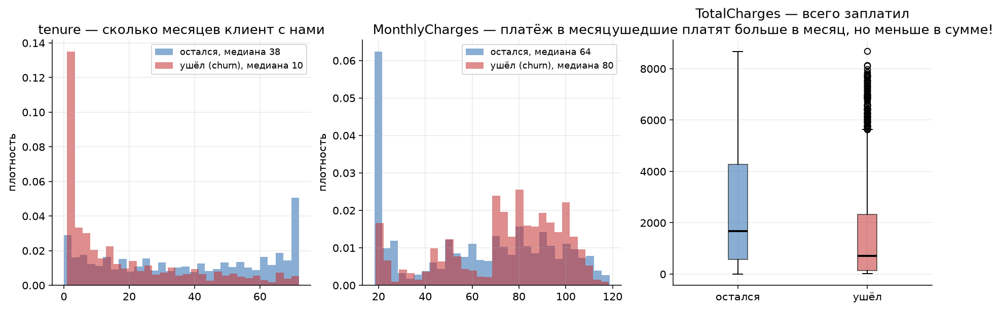

- **`tenure`**: ушедшие в среднем с компанией ~10 месяцев, оставшиеся — больше 3 лет. Пик оттока — у совсем новых клиентов (пришли по рекламе и сразу ушли); самые лояльные — те, кто с компанией 6 лет.
- **`MonthlyCharges`**: у ушедших платёж **выше**. Гипотеза: им дорого, нашли оператора выгоднее.
- **`TotalCharges`**: у ушедших сумма **ниже**.

**Парадокс?** Платят в месяц больше, а в сумме меньше. Объяснение:

$$\text{TotalCharges} \approx \text{MonthlyCharges} \times \text{tenure}$$

Ушедшие платят больше в месяц, но **живут** как клиенты намного меньше. (На данных корреляция между `MonthlyCharges × tenure` и `TotalCharges` — 0.9996.)

### Категориальные признаки

`⏱ 0:35`

Приём: для каждой категории считаем **долю ушедших** и сравниваем со **средней долей** (26.5%, пунктир).

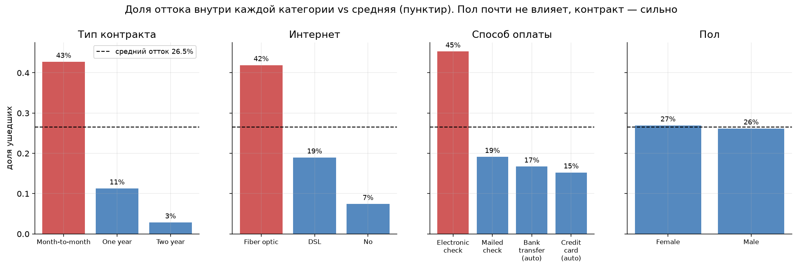

Выводы (такие и надо писать в EDA):
- **Тип контракта — самый сильный фактор.** Помесячный: уходят 43%. На год: 11%. На два года: 3%.
- **Интернет**: с оптоволокном уходят чаще (42%), чем с DSL (19%).
- **Оплата электронным чеком**: 45% оттока против 15–19% у остальных.
- **Пол не влияет**: 27% vs 26%.

> ⚠️ Это **однофакторный** анализ — каждый признак отдельно. Признак, бесполезный сам по себе, может работать в комбинации с другими.

---

## 4. Бины, пары признаков и feature engineering

### Бинаризация числового признака

`⏱ 0:38`

Гистограмма `tenure` неравномерная и шумная. Приём: **разбить на интервалы (бины)** и посмотреть отток в каждом.

```python
pd.cut(df.tenure, [-1, 6, 12, 24, 36, 48, 60, 72])  # границы задаём сами (экспертно)
pd.qcut(df.tenure, 5)                                # по квантилям: в каждом бине одинаковое число объектов
```

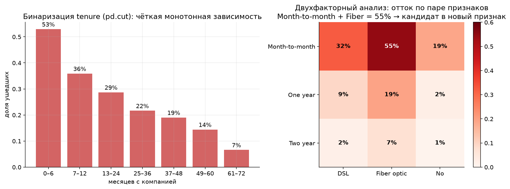

Слева — чёткая **монотонная** зависимость: 53% оттока среди новичков → 7% среди «старожилов». Бинаризованный признак можно отдать модели вместо сырого или вместе с ним («я бы попробовала и так, и так» — лектор).

### Двухфакторный анализ

`⏱ 0:41`

Смотрим отток сразу по **паре** признаков (`pd.pivot_table`). Справа на картинке: контракт × интернет. Выделяется ячейка **помесячный контракт + оптоволокно = 55%** оттока — вдвое выше среднего.

**Как это использовать?** Создать новый бинарный признак:

```python
df["m2m_fiber"] = ((df.Contract == "Month-to-month") &
                   (df.InternetService == "Fiber optic")).astype(int)
```

Это и есть **feature engineering** — придумывание новых признаков по итогам анализа.

**Зачем, если модель «сама найдёт»?** `⏱ 0:47`
- **Линейная модель не найдёт.** Она складывает признаки с весами и не умеет учитывать их взаимодействия, пока мы их явно не добавим.
- **Деревья и бустинги** могут найти сами, но могут зацепиться за другую, менее осмысленную комбинацию. Подсветить явную зависимость полезно в любом случае.

### Лишние и дублирующиеся признаки

`⏱ 0:44`

- У 6 признаков (`OnlineSecurity`, `OnlineBackup`, `DeviceProtection`, `TechSupport`, `StreamingTV`, `StreamingMovies`) есть значение `No internet service`. Проверка: это **одни и те же 1526 клиентов** — те, у кого `InternetService = No`. Информация продублирована 7 раз.
- `TotalCharges` ≈ `MonthlyCharges × tenure` — почти полностью выражается через другие два → в каком-то смысле лишний. (Линейная модель *произведение* сама не построит, а вот сумму — может; так что для неё сырой `TotalCharges` всё же несёт информацию.)

> EDA для картинок и текстов `⏱ 0:49`: глубокий EDA (корреляции, пары) там не нужен — нейросети сами извлекают признаки. Достаточно проверить дубликаты, ошибки, баланс классов, нормализацию. Глубокий EDA — для **табличных** данных (включая временные ряды и рекомендации).

---

## 5. Корреляция числовых признаков: Пирсон, Спирмен, Кендалл

### Квартет Анскомба: зачем смотреть на графики

`⏱ 0:53`

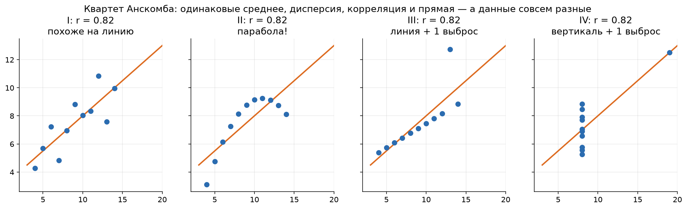

У всех четырёх наборов **одинаковые** среднее, дисперсия, корреляция (0.82) и даже прямая регрессии. А данные — совсем разные: линия, парабола, линия с выбросом, вертикаль с одним выбросом.

**Вывод:** высокая корреляция ≠ «точки лежат вдоль прямой». Одно число не описывает форму зависимости. А форма важна: линейная модель хорошо моделирует только линейные зависимости.

### Корреляция Пирсона

`⏱ 0:54`

$$r_{xy} = \frac{\sum_i (x_i - \bar x)(y_i - \bar y)}{\sqrt{\sum_i (x_i - \bar x)^2}\ \sqrt{\sum_i (y_i - \bar y)^2}}$$

**Как понять формулу на пальцах:**
1. Вычитаем средние → центрируем столбцы: теперь знак показывает, выше или ниже среднего значение.
2. Числитель — сумма произведений отклонений (это **скалярное произведение** центрированных векторов). Если $x$ и $y$ одновременно выше или одновременно ниже среднего — произведения положительные → сумма большая положительная.
3. Знаменатель — произведение «длин» векторов. Делим, чтобы получить число от −1 до 1 (по сути, косинус угла между векторами).

| $r$ | смысл |
|---|---|
| ≈ 1 | сильная прямая линейная связь |
| ≈ −1 | сильная обратная линейная связь |
| ≈ 0 | **линейной** связи нет (а нелинейная может быть!) |

✍️ **Руками** (дома из лекции 1): $x = (1, 2, 3)$, $y = (2, 3, 5)$.
$\bar x = 2$, $\bar y = 10/3$. Отклонения: $x$: $(-1, 0, 1)$, $y$: $(-\tfrac43, -\tfrac13, \tfrac53)$.
Числитель: $(-1)(-\tfrac43) + 0 + (1)(\tfrac53) = 3$.
Знаменатель: $\sqrt{1 + 0 + 1}\cdot\sqrt{\tfrac{16 + 1 + 25}{9}} = \sqrt2 \cdot \sqrt{4.67} \approx 3.06$.
$r \approx 3 / 3.06 = 0.98$ — почти идеальная прямая связь.

```python
df.corr()                    # по умолчанию Пирсон
```

На churn: `tenure`–`TotalCharges` = 0.83, `MonthlyCharges`–`TotalCharges` = 0.65, `SeniorCitizen`–`tenure` ≈ 0.

### Корреляция Спирмена

`⏱ 0:58`

**Идея:** «связь» — это когда одна величина растёт, а другая одновременно растёт (или падает). Здесь нет ничего про *линейность*. Поэтому заменим значения их **рангами** (порядковыми номерами в отсортированном списке) и сравним ранги.

$$\rho = 1 - \frac{6\sum_i d_i^2}{n(n^2 - 1)}, \qquad d_i = \text{rank}(x_i) - \text{rank}(y_i)$$

(формула для случая без одинаковых значений; в общем случае $\rho$ = Пирсон, посчитанный на рангах).

Если ранги совпадают ($d_i = 0$) → $\rho = 1$. Чем сильнее расходятся — тем меньше.

✍️ **Руками** (пример из лекции: IQ и время решения задач, 5 школьников):

| | IQ | ранг IQ | время, с | ранг времени | $d$ | $d^2$ |
|---|---|---|---|---|---|---|
| A | 100 | 2 | 120 | 4 | −2 | 4 |
| B | 110 | 4 | 100 | 3 | 1 | 1 |
| C | 95 | 1 | 130 | 5 | −4 | 16 |
| D | 120 | 5 | 95 | 2 | 3 | 9 |
| E | 105 | 3 | 90 | 1 | 2 | 4 |

$$\rho = 1 - \frac{6 \cdot 34}{5 \cdot (25 - 1)} = 1 - \frac{204}{120} = -0.7$$

Сильная обратная связь: выше IQ → быстрее решают.

```python
df.corr(method="spearman")
```

На churn: `tenure`–`TotalCharges` по Пирсону 0.83, по Спирмену **0.89** — связь сильнее, чем «чисто линейная».

**Бонус Спирмена:** ранги не боятся выбросов (значение 10⁶ получит просто ранг $n$).

### Кендалл

Тоже ранговая корреляция, но считается через пары объектов: доля «согласованных» пар (у обоих признаков порядок одинаковый) минус доля «несогласованных». `df.corr(method="kendall")`. Детали — на курсе статистики.

### ⚠️ Чего не видит никто из них

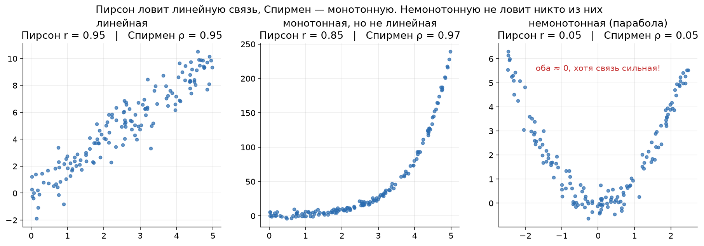

- **Линейная** связь: оба высокие.
- **Монотонная нелинейная** (экспонента): Спирмен = 1.0, Пирсон заметно ниже.
- **Немонотонная** (парабола): **оба ≈ 0**, хотя зависимость идеальная.

> В лекции прозвучало «Спирмен — мера *любой* взаимосвязи». Точнее — **монотонной**. Для немонотонных зависимостей нужны другие инструменты (графики, φK, взаимная информация).

**Главная мысль лектора:** «коэффициент корреляции» — это не название метода. По умолчанию все считают Пирсона, что не лучший выбор. Хочешь видеть любую монотонную связь — бери Спирмена или Кендалла.

---

## 6. Связь категориальных признаков: χ², V Крамера, φK

`⏱ 1:05`

Пирсона нельзя посчитать для «курит / не курит». One-hot для каждой пары плодит столбцы. Нужен свой инструмент.

### Статистика χ² (хи-квадрат)

`⏱ 1:08`

**Матрица сопряжённости** — сколько объектов попало в каждую пару категорий. Пример: курение × повышенное давление, 150 человек.

**Идея:** посчитаем, сколько людей было бы в каждой клетке, **если бы признаки были независимы**, и сравним с тем, что наблюдаем.

При независимости вероятности перемножаются: $P(\text{курит и давление}) = P(\text{курит}) \cdot P(\text{давление})$. Отсюда ожидаемая частота:

$$E_{ij} = n \cdot \frac{\text{итог строки}}{n} \cdot \frac{\text{итог столбца}}{n} = \frac{\text{итог строки} \times \text{итог столбца}}{n}$$

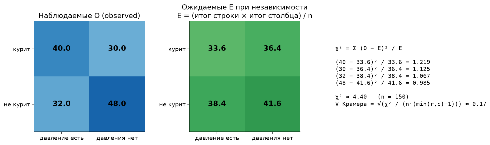

✍️ **Руками:** курят 70, с давлением 72, всего 150 → $E = 70 \cdot 72 / 150 = 33.6$. Наблюдаем **40** — больше, чем при независимости.

$$\chi^2 = \sum_{\text{клетки}} \frac{(O - E)^2}{E} \approx 1.22 + 1.13 + 1.07 + 0.99 = 4.40$$

- $\chi^2 = 0$ — наблюдаемое совпало с ожидаемым → независимы.
- Чем больше $\chi^2$ — тем сильнее зависимость.

**Проблема:** а 4.40 — это много или мало? Непонятно: χ² не ограничен сверху и растёт с размером выборки.

**Подход статистика:** сравнить с порогом при заданном уровне значимости (проверка гипотезы) — это на курсе статистики.
**Подход ML-инженера:** нормировать, чтобы получить «аналог корреляции» в [0, 1]. («Хорошие статистики надавали бы по рукам», — лектор. Это инженерное огрубление, но рабочее.)

### V Крамера

`⏱ 1:13`

$$V = \sqrt{\frac{\chi^2}{n\,(\min(r, c) - 1)}} \in [0, 1]$$

$r, c$ — число строк и столбцов таблицы. Для примера: $V = \sqrt{4.40 / (150 \cdot 1)} \approx 0.17$ — слабая связь.

В коде: библиотека `association_metrics` (колонки нужно привести к типу `category`).

### φK (phik) — одна шкала для всех типов признаков

`⏱ 1:16`

Проблема: Пирсон (число–число) и V Крамера (категория–категория) — **разные** меры, их нельзя сравнивать между собой (вспомни кружки и квадраты в Sweetviz).

**Идея φK — очень простая:**
1. Между категориями мы связь считать умеем (через χ²).
2. **Бинаризуем числовые признаки** — они станут категориальными.
3. Теперь все признаки категориальные → считаем связь между всеми парами на одной шкале [0, 1].

(В реальной формуле больше деталей. Для двух числовых признаков с нормальным распределением φK совпадает с $|r|$ Пирсона — то есть это **обобщение Пирсона** на любые типы признаков.)

Именно эту матрицу рисует ydata-profiling.

```python
import phik
df.phik_matrix(interval_cols=["tenure", "MonthlyCharges", "TotalCharges"])
```

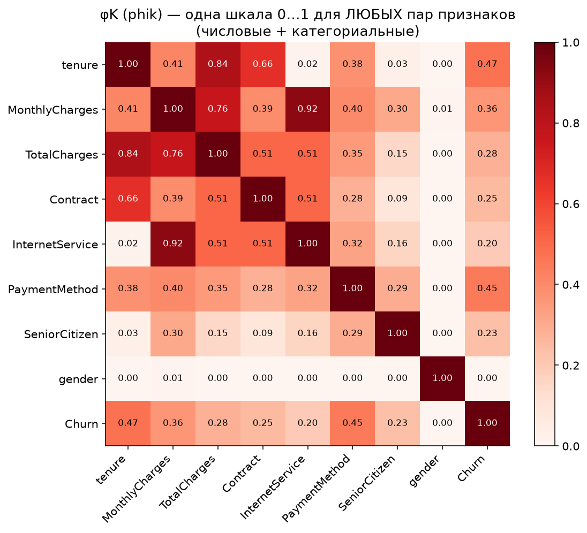

Что видно: `MonthlyCharges`–`InternetService` = 0.92 (оптоволокно дороже); `tenure`–`Contract` = 0.66; `gender` ни с чем не связан, в том числе с оттоком (0.00). Обрати внимание: φK ≥ 0 — **направление** связи он не показывает.

---

## 7. Корреляция ≠ причинность. Что сдавать как EDA

### Correlation is not causation

`⏱ 1:19`

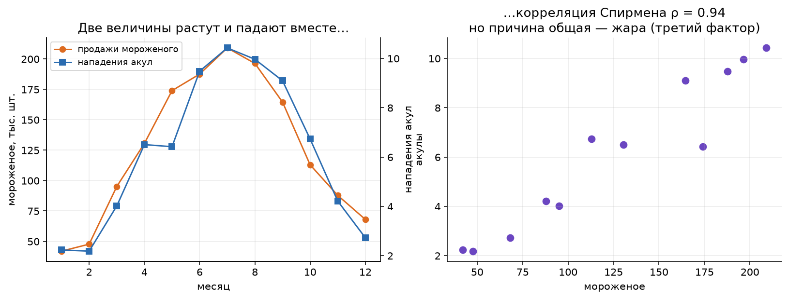

Продажи мороженого и нападения акул на курортах Египта сильно коррелируют. Мороженое не привлекает акул: есть **третий, общий фактор** — лето, жара, больше людей купается и ест мороженое.

Так же: если `tenure` скоррелирован с оттоком, это ещё **не доказывает**, что именно `tenure` *вызывает* отток (хотя, скорее всего, связь есть). Корреляция — это **взаимосвязь**, а не причина. Причину проверяют экспериментом (A/B-тестом).

### Что делать с корреляциями

`⏱ 1:23`

Данные **не меняем** из-за корреляций (меняем только при пропусках, ошибках, аномалиях). Корреляции — для **понимания**:
- какие признаки связаны с target → вероятно, важны;
- какие признаки дублируют друг друга → кандидаты на удаление;
- какие пары интересны → кандидаты на новые признаки.

### Результат EDA

`⏱ 1:22`

Не набор графиков, а **полотно текста с инсайтами**:
- выводы однофакторного анализа (по каждому признаку);
- что показали корреляции;
- гипотезы для проверки;
- что это значит для модели: какие метрики подойдут (дисбаланс!), какие признаки важны, какие новые признаки придумали, какие можно удалить.

«Просто графики — это не EDA, это просто графики».

---

# Часть 2. Линейная регрессия

`⏱ 1:30` — эта часть для всех (Base).

## 8. Векторная запись

`⏱ 1:31`

Напоминание: прогноз цены дома по площади $x_1$ и числу комнат $x_2$:

$$a(x) = w_0 + w_1 x_1 + w_2 x_2$$

**Плюсы модели:** простая (всё в первой степени, просто сумма) и **самая интерпретируемая** — каждый вес показывает вклад признака в ответ.

### Избавляемся от отдельного $w_0$

Все слагаемые выглядят как «вес × признак», кроме $w_0$. Трюк: **добавим константный признак $x_0 = 1$** (столбец из единиц). Тогда $w_0 = w_0 \cdot x_0$, и все слагаемые одинаковые:

$$a(x) = w_0 x_0 + w_1 x_1 + \dots + w_d x_d = \sum_{j=0}^{d} w_j x_j = \langle w, x \rangle$$

Это **скалярное произведение** вектора весов $w = (w_0, \dots, w_d)$ и вектора признаков $x = (1, x_1, \dots, x_d)$.

Для **всей выборки сразу**: $X$ — матрица $\ell \times (d+1)$ (с первым столбцом из единиц), тогда вектор прогнозов:

$$\hat y = Xw$$

**Зачем так писать?** Не только ради красоты. В NumPy матричное умножение (`X @ w`) **в разы быстрее**, чем цикл со сложением чисел (векторизация).

### Интерпретация весов

`⏱ 1:37`

Обученная модель: $a(x) = w_0 + 0.138\,x_1 + w_2 x_2$ (цена в млн ₽, площадь в м²).

**$w_1 = 0.138$:** +1 м² площади (при прочих равных) → **+138 тыс. ₽** к прогнозу. Если бы вес был отрицательный — прогноз бы уменьшался.

> Два разных вопроса интерпретации:
> - **«Какой вклад вносит признак в ответ?»** → смотрим веса на **исходных** (немасштабированных) признаках: «+1 м² → +138 тыс.».
> - **«Какой признак важнее?»** → сравниваем веса только **после масштабирования** (лекция 1).

Как подбирают веса: сегодня — **аналитическое решение** (раздел 14), через ~2 недели — **градиентный спуск**.

---

## 9. MSE vs MAE: выбросы

`⏱ 1:40`

Напоминание: просто разность $y - a$ брать нельзя (ошибки разных знаков сократятся). Два стандартных способа убрать знак:

$$\text{MSE} = \frac1\ell\sum_i (y_i - a(x_i))^2 \qquad \text{MAE} = \frac1\ell\sum_i |y_i - a(x_i)|$$

Лекция 1 дала ответ «уровня джуна» (убрать знак). Сегодня — **уровень мидла**: чем они реально отличаются.

### MSE и выбросы

`⏱ 1:42`

**Выброс** — объект, который плохо прогнозируется → на нём **большая ошибка**. А квадрат большую ошибку раздувает:

| ошибка | в MSE (квадрат) | в MAE (модуль) |
|---|---|---|
| 2 | 4 | 2 |
| 20 | **400** | 20 |

То есть в MSE несколько выбросов дают **основной вклад** в функцию потерь. Модель, минимизируя MSE, будет **подстраиваться под выбросы** — стараться уменьшить ошибку на 3–5 странных точках в ущерб всем остальным.

**MAE** штрафует все ошибки «в первой степени» — нет перевеса в сторону выбросов → модель **устойчивее**.

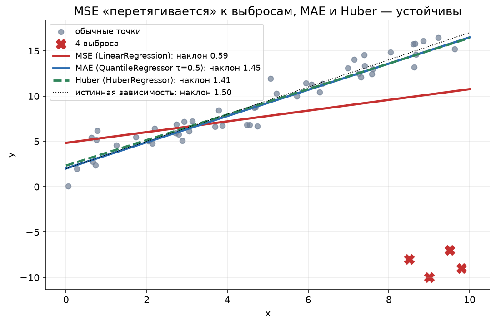

Четыре выброса «уронили» MSE-прямую (наклон 0.59 вместо истинных 1.50). MAE и Huber почти не заметили выбросов.

### Так что выбрать?

- Данные чистые (ошибки нашли и исправили) → **MSE**, всё будет хорошо.
- Выбросы есть, а чистить не хочется / нельзя → **MAE** (или Huber).
- **Но заранее правильного ответа нет!** MAE устойчивее, но итоговая **метрика** может оказаться лучше у MSE. Решает только эксперимент: обучить обе, сравнить метрику на отложенной выборке. `⏱ 1:59`

**Это не «быстрее/медленнее»** — это *разные задачи оптимизации* и, по сути, **разные модели**: формула прогноза у них одна ($\langle w, x\rangle$), а функция потерь — разная, поэтому и веса получатся разными.

**Почему в основном используют MSE?** `⏱ 2:13` «Потому что люди не любят думать»: `LinearRegression` в sklearn минимизирует только MSE и лежит на поверхности. MAE — через `QuantileRegressor(quantile=0.5)` или библиотеку `statsmodels`; Huber — `HuberRegressor`.

---

## 10. Константный прогноз: почему MSE → среднее, MAE → медиана

`⏱ 1:45`

### Что такое константный прогноз

Для **всех** объектов предсказываем **одно и то же число**. Например, «любой дом стоит 10 млн». Это **baseline** — «максимально тупая, но минимально осмысленная» модель, с которой начинают и с которой сравнивают все остальные. Если модель не бьёт константу — с ней что-то не так.

### Пример лектора

5 квартир: цены $[1.5,\ 2,\ 2,\ 2.5,\ 10]$ млн ₽. Последняя — вероятно, опечатка.

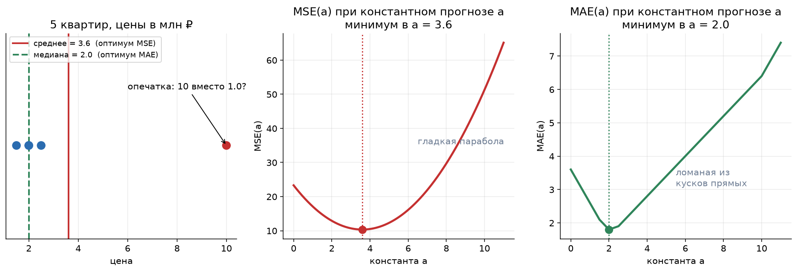

- Лучшая константа по **MSE** = среднее = **3.6** — больше цены *любой* нормальной квартиры. Опечатка утащила прогноз.
- Лучшая константа по **MAE** = медиана = **2.0** — опечатку не заметила.

### Почему это важно

`⏱ 1:49`

Объекты с **одинаковыми признаками и разными ответами** — обычное дело (одинаковые по площади и комнатам квартиры в разных районах). Модель на таких объектах обязана выдать **одно и то же число** (формула от признаков, а признаки одинаковые). Какое? Это и есть задача о лучшей константе для этой группы. Значит:

> **MSE-модель на группе одинаковых объектов предсказывает их среднее, MAE-модель — их медиану.** Отсюда и разница в устойчивости к выбросам.

### Доказательство для MSE

`⏱ 1:51`

На группе из $\ell$ объектов прогноз — одно число $a$. Функция потерь зависит только от $a$:

$$L(a) = \frac1\ell\sum_{i=1}^{\ell}(y_i - a)^2$$

Это парабола по $a$. Минимум — где производная равна нулю:

$$L'(a) = -\frac{2}{\ell}\sum_{i=1}^{\ell}(y_i - a) = 0 \ \Rightarrow\ \sum y_i - \ell a = 0 \ \Rightarrow\ \boxed{a = \frac1\ell\sum y_i = \bar y}$$

✍️ Проверка на примере: $\bar y = (1.5 + 2 + 2 + 2.5 + 10)/5 = 18/5 = 3.6$. ✓

### Доказательство для MAE

`⏱ 1:53`

$$L(a) = \frac1\ell\sum_{i=1}^{\ell}|y_i - a|$$

Производную «в лоб» не взять (у модуля излом). Рассуждаем иначе. Отсортируем ответы по возрастанию (это называется **вариационный ряд**): $y_{(1)} \le y_{(2)} \le \dots \le y_{(\ell)}$.

Возьмём $a$ = **медиана** (центральный элемент). Слева и справа от неё — поровну точек.

- **Сдвинем $a$ чуть вправо** на $\varepsilon$: у точек **справа** ошибка уменьшится на $\varepsilon$, у точек **слева** — увеличится на $\varepsilon$. Но слева точек теперь **больше** (медиана к ним присоединилась) → в сумме ошибка **выросла**.
- **Сдвинем влево** — симметрично, ошибка тоже вырастет.

Значит, в медиане — минимум. $\boxed{a = \text{median}(y)}$

✍️ На примере: у $a = 2$: $|1.5-2| + 0 + 0 + |2.5-2| + |10-2| = 0.5 + 0.5 + 8 = 9$; MAE = 1.8. Попробуй $a = 2.5$: $1 + 0.5 + 0.5 + 0 + 7.5 = 9.5$ — больше. ✓

> Медиана устойчива к выбросам, потому что ей «всё равно», *насколько* далеко крайние значения — важен только порядок. Среднее учитывает каждое значение целиком.

---

## 11. Квантильная функция потерь и функция Хубера

### Несимметричная цена ошибок

`⏱ 2:01`

MSE и MAE **симметричны**: перепрогноз на 10 млн и недопрогноз на 10 млн штрафуются одинаково. В жизни часто не так:

- **Недопрогноз опаснее:** медицина (занизить вероятность болезни хуже, чем завысить); запасы на складе (не хватило товара — потеряли продажи); время доставки («обещаем не позже, чем…»).
- **Перепрогноз опаснее:** бюджет на год (заложили больше — деньги заморожены), логистика с дорогой арендой мощностей.

### Квантильная (pinball) функция потерь

`⏱ 2:03`

Обозначим ошибку $z = y - a(x)$: $z > 0$ — **недопрогноз** (предсказали меньше, чем на самом деле), $z < 0$ — **перепрогноз**.

$$\rho_\tau(z) = \begin{cases} \tau \cdot z, & z \ge 0 \quad (\text{недопрогноз}) \\ (\tau - 1)\cdot z = (1 - \tau)|z|, & z < 0 \quad (\text{перепрогноз}) \end{cases}, \qquad \tau \in (0, 1)$$

Это «галочка» с **разными наклонами** сторон:

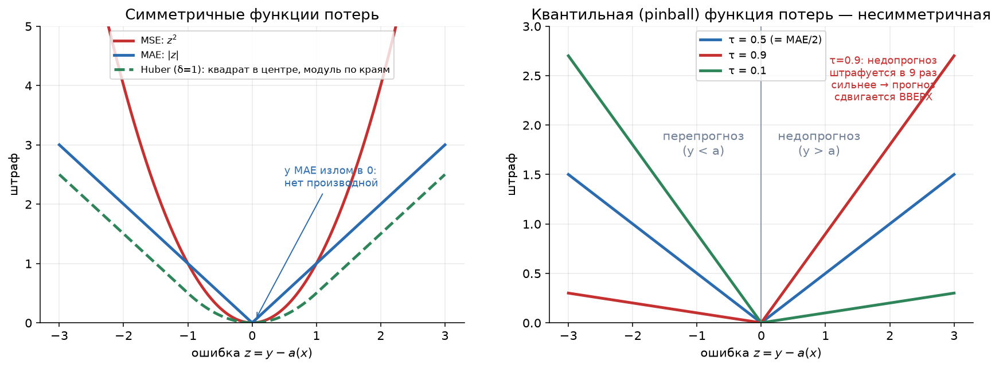

- **τ = 0.5**: наклоны одинаковые → это просто $\tfrac12$ MAE.
- **τ = 0.9**: недопрогноз штрафуется с весом 0.9, перепрогноз — 0.1 (в 9 раз слабее). Модели «выгоднее» ошибиться в большую сторону → **прогноз сдвигается вверх**.
- **τ = 0.1**: наоборот, прогноз сдвигается вниз.

**Теорема** (обобщение предыдущего раздела): оптимальная константа для квантильной потери — **τ-квантиль** целевой переменной. MSE → среднее, MAE → медиана (= 0.5-квантиль), квантильная → τ-квантиль. Модель называется **квантильная регрессия**.

**Как выбрать τ** — из бизнес-смысла задачи:
- опаснее **недопрогноз** → **τ > 0.5**;
- опаснее **перепрогноз** → **τ < 0.5**.

> ⚠️ В лекции (2:04) сказано наоборот («если опаснее перепрогнозировать, берём τ ближе к 1»). При записи $z = y - a$, как на слайде, верно то, что написано здесь — проверь на графике: красная линия τ = 0.9 круто растёт именно справа, в зоне недопрогноза. Скорее всего, оговорка.

### Интервальный прогноз

`⏱ 2:05`

Обучим **несколько** квантильных регрессий — получим не точку, а **интервал**:

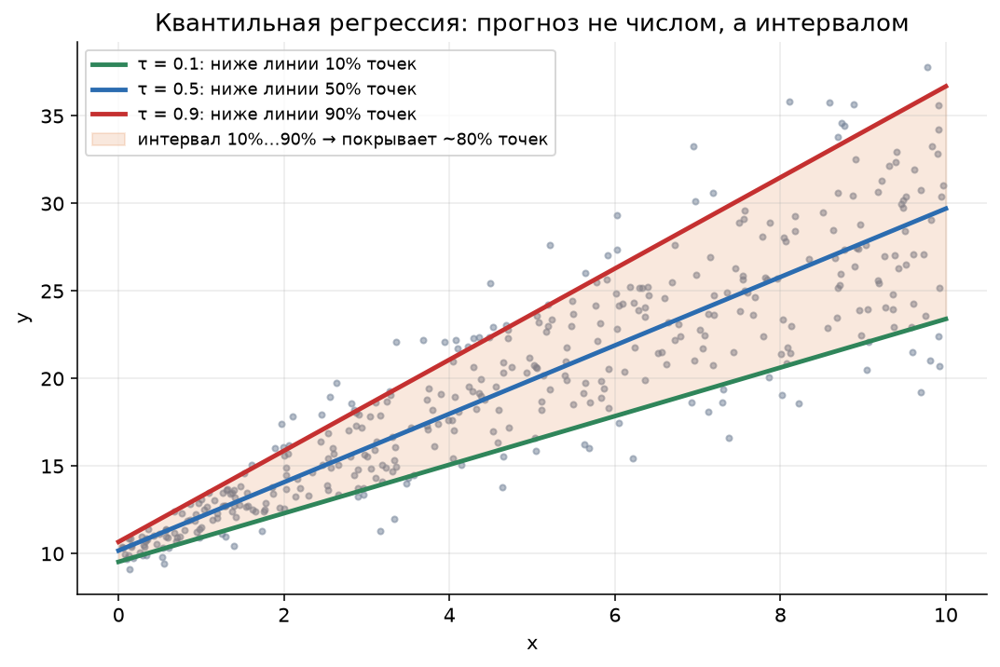

Модели с τ = 0.1 и τ = 0.9 дают коридор, в который попадает ≈ 80% наблюдений. Заметь: коридор **расширяется** там, где данные шумнее — обычная регрессия этого не показала бы.

> ⚠️ В лекции прозвучало: «модели на 40% и 60% квантилях дают интервал с уверенностью от 40 до 60%». Точнее: между 40%- и 60%-квантилями лежит лишь **≈20%** наблюдений (60 − 40). Для «80%-интервала» нужны квантили 10% и 90%.

### Функция потерь Хубера

`⏱ 2:07`

Недостатки двух классических функций:
- **MSE** на больших ошибках подстраивается под выбросы;
- **MAE** в нуле имеет **излом** — производной нет, а рядом с нулём она скачет от −1 до +1. Оптимизаторам (градиентный спуск) это неудобно.

**Гибрид:** около нуля — квадрат (гладко), на больших ошибках — модуль (устойчиво):

$$L_\delta(z) = \begin{cases} \tfrac12 z^2, & |z| \le \delta \\ \delta\left(|z| - \tfrac12\delta\right), & |z| > \delta \end{cases}$$

Функция непрерывная и гладкая в точке перехода. Порог $\delta$ задаём сами. В sklearn: `HuberRegressor(epsilon=1.35)` (по умолчанию 1.35 — в единицах масштабированного остатка; это гиперпараметр, его можно подбирать).

### Итого про функции потерь

| Функция | Оптимальная константа | Выбросы | Гладкость | Когда |
|---|---|---|---|---|
| MSE | среднее | чувствительна | гладкая | чистые данные; есть точная формула |
| MAE | медиана | устойчива | излом в 0 | есть выбросы |
| Huber | между средним и медианой | устойчива | гладкая | выбросы + градиентная оптимизация |
| Quantile τ | τ-квантиль | устойчива | излом в 0 | несимметричная цена ошибок, интервалы |

Придумать свою функцию потерь = придумать **новую модель**. Обычно не нужно, но можно, если это обосновано и даёт хорошую метрику.

---

## 12. Категориальные и немонотонные признаки

`⏱ 2:16`

Добавим в задачу о доме **район** $x_3$ и **расстояние от МКАД** $x_4$. Что пойдёт не так, если подставить их в формулу как есть?

### Проблема 1: категориальный признак (район)

Район — не число, подставить в формулу нельзя. **Можно ли пронумеровать** районы 1, 2, 3…? **Нет:** модель будет воспринимать номера как величины. «Дудкино = 2, Мамыри = 1» → модель решит, что Дудкино даёт вдвое больший вклад, чем Мамыри. Порядка между районами нет — нумерация его выдумывает.

**One-hot encoding** — под каждую категорию свой бинарный столбец-индикатор:

| район | → | Барвиха | Дудкино | Мамыри |
|---|---|---|---|---|
| Барвиха | | 1 | 0 | 0 |
| Мамыри | | 0 | 0 | 1 |
| Дудкино | | 0 | 1 | 0 |

Теперь у каждого района свой вес — «надбавка за район». (Если категорий тысячи, one-hot плох — будут другие кодировки, в т.ч. target encoding, через пару недель.)

```python
pd.get_dummies(df, columns=["district"], drop_first=True)
# или sklearn.preprocessing.OneHotEncoder(drop="first")
```

### Ловушка one-hot (dummy trap)

`⏱ 2:21`

В каждой строке ровно одна единица → **сумма всех one-hot столбцов = 1** в каждой строке.

**С чем тут линейная зависимость?** (Любимый экзаменационный вопрос лектора.) С **константным признаком $x_0 = 1$**:

$$x_{\text{Барвиха}} + x_{\text{Дудкино}} + x_{\text{Мамыри}} = 1 = x_0$$

Один столбец матрицы $X$ выражается через другие → столбцы **линейно зависимы** → матрица $X^TX$ **вырождена** → в аналитической формуле (раздел 14) обратной матрицы не существует.

Интуитивно: модель не может однозначно решить, что считать «базой», — можно прибавить 100 к $w_0$ и вычесть 100 из всех весов районов, и прогнозы не изменятся. Решений бесконечно много.

**Решение:** создавать на **один столбец меньше**, чем категорий (`drop_first=True`). Какой убрать — не важно; его район станет «базовым», а веса остальных — надбавками относительно него.

> Это важно **только для линейной регрессии без регуляризации**. Для деревьев, бустингов и регрессии с регуляризацией полный one-hot не мешает.

### Проблема 2: немонотонная зависимость (расстояние от МКАД)

`⏱ 2:24`

Цена от расстояния зависит **немонотонно**: у самого МКАД — дёшево (шумно, грязно), в 10–30 км — дорого (рядом с Москвой, но чисто), дальше — снова дешевле («уже Рязань»).

А линейная регрессия умеет только монотонное: вес > 0 — признак растёт, прогноз растёт; вес < 0 — падает. Одна прямая.

**Решение: бинаризация + one-hot.** Разбиваем расстояние на интервалы (0–10, 10–30, 30–50, 50+ км) и каждому даём свой бинарный признак. Теперь у каждого интервала свой вес:

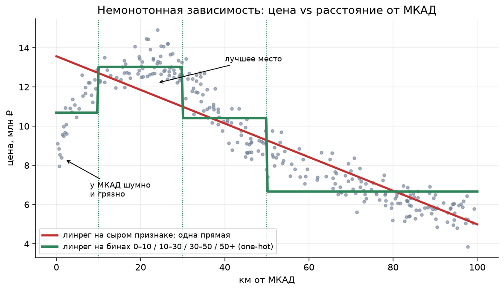

Красная прямая не может поймать «горб». Зелёная ступенчатая функция на бинах — ловит.

Как бить на бины: по квантилям (поровну объектов в каждом) или на равные отрезки; можно тестировать разные варианты. Бины теряют часть информации, но это может даже помочь — меньше риск переобучиться.

**Порядок действий:** нарисовать график зависимости target от признака → если зависимость немонотонная и признак важен — бинаризовать; если не важен — можно выкинуть.

Альтернатива — придумать функцию, которая «выпрямит» зависимость, но это сложнее.

---

## 13. Почему регрессия «линейная»

`⏱ 2:28`

Хочется сказать: «потому что признаки входят в первой степени». **Нет.** Модель

$$a(x) = w_0 + w_1 x + w_2 x^2 + w_3 \log x + w_4 \sin x$$

— тоже **линейная регрессия**.

**Линейная — по весам**, а не по признакам. Почему важны именно веса? Обучение — это оптимизация функции потерь **по весам**. $x$ и $y$ — константы (известные числа из данных), и неважно, что с ними сделано: хоть квадрат, хоть синус, хоть экспонента. Пока веса входят **в первой степени и суммой**, вся математика линейной модели работает (в том числе формула из раздела 14).

Следствия:
- **Полиномиальная регрессия** (признаки в степенях) — это линейная регрессия на новых признаках $x, x^2, x^3, \dots$
- Можно делать любой **feature engineering**: квадраты, логарифмы, произведения пар, бины — модель останется линейной, а зависимость от исходных признаков станет нелинейной.

**Используют ли линейную регрессию на практике?** `⏱ 2:45` Да, часто:
- самая **интерпретируемая** модель («начальник не понимает вашу нейросеть — используем линейную»);
- с feature engineering ловит и нелинейные зависимости;
- **нейросети — это много линейных моделей**, соединённых нелинейностями. Поняв линейные модели, поймёшь и базовый кирпичик нейросетей.

---

## 14. Аналитическое решение

`⏱ 2:31`

Для MSE можно найти веса **точной формулой** — без перебора и итераций. Подставляешь данные — получаешь ответ.

### Вывод

**1. MSE в матричном виде.** Прогноз на всей выборке — $Xw$, ответы — $y$. Вектор ошибок $Xw - y$. Сумма квадратов его координат — это квадрат **нормы** вектора:

$$Q(w) = \|Xw - y\|^2 \to \min_w$$

(деление на $\ell$ на точку минимума не влияет, его опускаем)

**2. Раскрываем.** Квадрат нормы = вектор, умноженный скалярно сам на себя: $\|v\|^2 = v^Tv$.

$$Q(w) = (Xw - y)^T(Xw - y) = w^TX^TXw - w^TX^Ty - y^TXw + y^Ty$$

Два средних слагаемых **равны**: каждое — это число (вектор, скалярно умноженный на вектор), и $w^TX^Ty = (y^TXw)^T$, а транспонированное число — то же число. Складываем:

$$Q(w) = w^TX^TXw - 2y^TXw + y^Ty$$

**3. Градиент.** В многомерном случае вместо производной — **градиент** (вектор частных производных по каждому $w_j$). Правила как для чисел: $(a w^2)' = 2aw$, $(bw)' = b$, $c' = 0$:

$$\nabla_w Q = 2X^TXw - 2X^Ty$$

**4. Приравниваем к нулю** (как в школе ищем вершину параболы):

$$X^TXw = X^Ty$$

**5. Выражаем $w$.** Сократить на $X^T$ **нельзя** — это матрица, не число (и размеры не сойдутся). Умножаем слева на обратную матрицу $(X^TX)^{-1}$:

$$\boxed{w^* = (X^TX)^{-1}X^Ty}$$

Это называется **нормальное уравнение** или **метод наименьших квадратов (МНК)**.

### ✍️ Считаем руками

Те же три дома из лекции 1: $x = (1, 2, 3)$, $y = (2, 3, 5)$. Добавляем столбец единиц:

$$X = \begin{pmatrix} 1 & 1 \\ 1 & 2 \\ 1 & 3 \end{pmatrix}, \qquad y = \begin{pmatrix} 2 \\ 3 \\ 5 \end{pmatrix}$$

$$X^TX = \begin{pmatrix} 1+1+1 & 1+2+3 \\ 1+2+3 & 1+4+9 \end{pmatrix} = \begin{pmatrix} 3 & 6 \\ 6 & 14 \end{pmatrix}, \qquad X^Ty = \begin{pmatrix} 2+3+5 \\ 2+6+15 \end{pmatrix} = \begin{pmatrix} 10 \\ 23 \end{pmatrix}$$

Обратная к $2 \times 2$: $\begin{pmatrix} a & b \\ c & d\end{pmatrix}^{-1} = \frac{1}{ad - bc}\begin{pmatrix} d & -b \\ -c & a\end{pmatrix}$. Определитель $3 \cdot 14 - 6 \cdot 6 = 6$:

$$(X^TX)^{-1} = \frac16\begin{pmatrix} 14 & -6 \\ -6 & 3 \end{pmatrix}$$

$$w^* = \frac16\begin{pmatrix} 14 \cdot 10 - 6 \cdot 23 \\ -6 \cdot 10 + 3 \cdot 23 \end{pmatrix} = \frac16\begin{pmatrix} 2 \\ 9 \end{pmatrix} = \begin{pmatrix} 0.333 \\ 1.5 \end{pmatrix}$$

Ровно те веса $w_0 = 1/3$, $w_1 = 1.5$, которые в лекции 1 «нашёл компьютер». Теперь видно, как именно.

```python
import numpy as np
X = np.array([[1, 1], [1, 2], [1, 3]], float)
y = np.array([2, 3, 5], float)
w = np.linalg.solve(X.T @ X, X.T @ y)   # → [0.333, 1.5]
# solve(A, b) решает A w = b устойчивее, чем inv(A) @ b
```

### Проблемы аналитического решения

`⏱ 2:38`

**1. Долго при большом числе признаков.** $X^TX$ — матрица $d \times d$ (по числу **признаков**). Обращение стоит $O(d^3)$ операций. При миллионе признаков — неподъёмно. (От числа объектов $\ell$ стоимость растёт лишь линейно.)

**2. Вырожденная и плохо обусловленная матрица.**
- Если столбцы $X$ **линейно зависимы** (как при полном one-hot) → $\det(X^TX) = 0$ → обратной нет → решения по формуле нет.
- Если столбцы **почти** линейно зависимы (корреляция 0.99) → $\det \approx 0$ → в обратной матрице **огромные числа** → веса становятся нестабильными, а вычисления — численно неточными. Такая матрица называется **плохо обусловленной**.

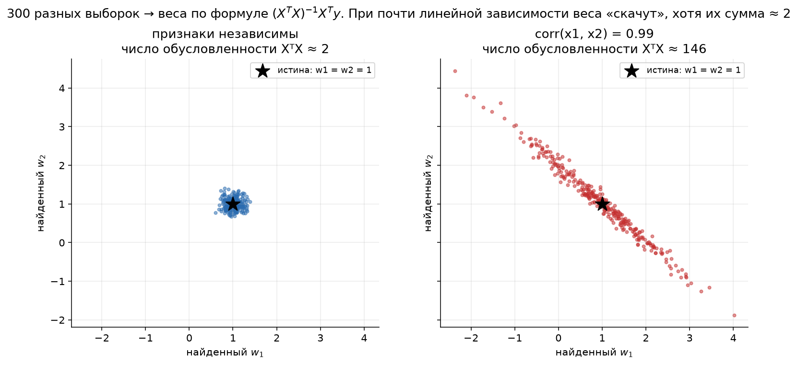

Эксперимент: истинные веса $w_1 = w_2 = 1$. Генерируем 300 выборок и считаем веса по формуле. Признаки независимы → веса кучно около истины. Признаки скоррелированы на 0.99 → веса **разлетаются** вдоль диагонали (от −2 до 4), хотя их сумма стабильно ≈ 2. Модель знает, что «вместе $x_1$ и $x_2$ дают +2», но не может решить, как поделить вклад. Это та самая **мультиколлинеарность**, которую мы видели в лекции 1 на признаках `s1`/`s2` датасета diabetes.

**3. Формула есть только для MSE.** Для MAE, Хубера, квантильной потери точной формулы нет — нужны итеративные методы (градиентный спуск, следующие лекции).

### Как с этим живёт sklearn

`⏱ 2:42`

`LinearRegression` в sklearn находит **то же самое** решение МНК, но **не обращает матрицу «в лоб»**: внутри `scipy.linalg.lstsq` — численно устойчивый метод (на основе SVD-разложения). Что это значит на практике (проверено):
- на полном one-hot (dummy trap) sklearn **не падает**, а возвращает одно из бесконечного множества решений (с минимальной нормой весов). Прогнозы правильные, но веса уже не интерпретировать как «надбавки к базовому району»;
- ручной `np.linalg.inv(X.T @ X)` на почти вырожденной матрице может **не выдать ошибку**, а молча вернуть мусор (определитель вышел ~10⁻¹², а не ровно 0 — из-за погрешностей вычислений).

> Лектор упомянула псевдообратную матрицу (`np.linalg.pinv`) как вариант при вырожденности — это как раз то, к чему по смыслу сводится `lstsq`. А настоящее «лекарство» от плохой обусловленности — **регуляризация** (будет дальше в курсе).

---

## 15. Итог в одной таблице

| Тема | Суть одной фразой |
|---|---|
| Результат EDA | Текстовые выводы и гипотезы, а не графики |
| Автоотчёты | ydata-profiling / Sweetviz / AutoViz — базовый EDA за минуту |
| Дисбаланс классов | Влияет и на обучение, и на выбор метрики |
| Анализ по target | Доля оттока в каждой категории / бине vs средняя |
| Пары признаков | Сильную пару → новый бинарный признак (линейная модель сама не найдёт) |
| Квартет Анскомба | Одинаковая корреляция — разные данные. Смотри графики |
| Пирсон | Линейная связь, $[-1, 1]$ |
| Спирмен / Кендалл | Монотонная связь через ранги, устойчивы к выбросам |
| χ² / V Крамера | Связь категорий: наблюдаемые vs ожидаемые при независимости частоты |
| φK | Бинаризуем числа → одна шкала [0, 1] для всех типов |
| Correlation ≠ causation | Возможен общий скрытый фактор |
| $a(x) = \langle w, x\rangle$ | Константный признак $x_0 = 1$; на выборке $Xw$ |
| MSE | Оптимум — среднее; чувствительна к выбросам |
| MAE | Оптимум — медиана; устойчива; излом в нуле |
| Quantile τ | Оптимум — τ-квантиль; τ > 0.5 → прогноз выше (недопрогноз дорог); интервалы |
| Huber | Квадрат в центре + модуль на хвостах |
| Baseline | Константный прогноз — модель-ориентир |
| One-hot | Категория → индикаторы; на 1 столбец меньше (dummy trap) |
| Немонотонность | Бины + one-hot |
| «Линейная» | По весам; с признаками — что угодно |
| МНК | $w = (X^TX)^{-1}X^Ty$; $O(d^3)$, ломается при мультиколлинеарности, только для MSE |
| Следующая неделя | Почему MSE ↔ нормальный шум (Middle+), метрики, валидация, пайплайны, Streamlit |
