# Лекция 3 — расширенный конспект

**Часть 1: откуда берутся функции потерь (метод максимального правдоподобия). Часть 2: метрики регрессии, переобучение, feature engineering, пайплайны**

> Этот файл можно читать **вместо просмотра лекции**. Краткая версия с картой и самопроверкой — [lecture_03.md](lecture_03.md).
> `⏱ 0:24` — где смотреть в записи. Графики строит [scripts/lecture_03_plots.py](scripts/lecture_03_plots.py); результаты семинара воспроизведены на **том же датасете** (UCI Automobile, `data/imports-85.data`).

## Содержание

**Часть 1 (Pro). Почему MSE и почему MAE**
1. [Где мы остановились](#1-где-мы-остановились)
2. [Метод максимального правдоподобия на монетке](#2-метод-максимального-правдоподобия-на-монетке)
3. [Линейная регрессия как вероятностная модель → MSE](#3-линейная-регрессия-как-вероятностная-модель--mse)
4. [Когда предположения нарушаются](#4-когда-предположения-нарушаются)
5. [Тяжёлые хвосты и шум Лапласа → MAE](#5-тяжёлые-хвосты-и-шум-лапласа--mae)
6. [Huber и общий принцип](#6-huber-и-общий-принцип)
7. [Выброс, кластер или шум?](#7-выброс-кластер-или-шум)

**Часть 2 (Base). Метрики и практика**

8. [MSE, RMSE, MAE и baseline](#8-mse-rmse-mae-и-baseline)
9. [R² и adjusted R²](#9-r²-и-adjusted-r²)
10. [Относительные метрики: MSLE, MAPE, SMAPE, WAPE](#10-относительные-метрики-msle-mape-smape-wape)
11. [Как выбрать метрику](#11-как-выбрать-метрику)
12. [Семинар: от сырых данных до модели](#12-семинар-от-сырых-данных-до-модели)
13. [Переобучение](#13-переобучение)
14. [Feature engineering](#14-feature-engineering)
15. [Pipeline и утечка данных](#15-pipeline-и-утечка-данных)
16. [Итог в одной таблице](#16-итог-в-одной-таблице)

---

# Часть 1. Почему MSE и почему MAE

## 1. Где мы остановились

`⏱ 0:07`

Из лекции 2 мы знаем:
- прогноз линейной регрессии $a(x) = \langle w, x\rangle$, обучение — минимизация функции потерь;
- **MSE** чувствительна к выбросам (квадрат раздувает большие ошибки), оптимальная константа — **среднее**;
- **MAE** устойчива к выбросам, оптимальная константа — **медиана**.

Но открытый вопрос остался: **почему именно квадрат?** Четвёртая степень тоже убирает знак. Аргумент «у модуля нет производной в нуле» слабый — это всего одна точка. Нужно более глубокое обоснование. Это ответ «уровня Middle+», который лектор обещала, и он требует одного инструмента из статистики.

---

## 2. Метод максимального правдоподобия на монетке

`⏱ 0:14`

### Задача

Есть **нечестная** монетка (сдвинули центр масс). Неизвестно, с какой вероятностью $p$ выпадает орёл. Бросили 10 раз — выпало **7 орлов**. Какое $p$?

Интуиция говорит 0.7. Давайте это **обоснуем**.

### Идея

Будем **перебирать** возможные значения $p$ и для каждого считать: *насколько вероятно было увидеть именно наш результат* (7 орлов из 10), если бы монетка имела такое $p$. Выберем $p$, при котором это максимально вероятно.

Вероятность получить ровно $k$ успехов из $n$ (биномиальное распределение):

$$P(7 \text{ орлов из } 10 \mid p) = C_{10}^{7}\, p^{7}\,(1-p)^{3}$$

$C_{10}^7 = 120$ — сколькими способами можно выбрать 7 бросков из 10, на которых выпал орёл.

✍️ **Руками:**

| $p$ | $120 \cdot p^7 \cdot (1-p)^3$ |
|---|---|
| 0.1 | $120 \cdot 10^{-7} \cdot 0.729 \approx 0.000009$ |
| 0.5 | $120 \cdot 0.5^{10} = 120/1024 \approx 0.117$ |
| **0.7** | $120 \cdot 0.0824 \cdot 0.027 \approx$ **0.267** |

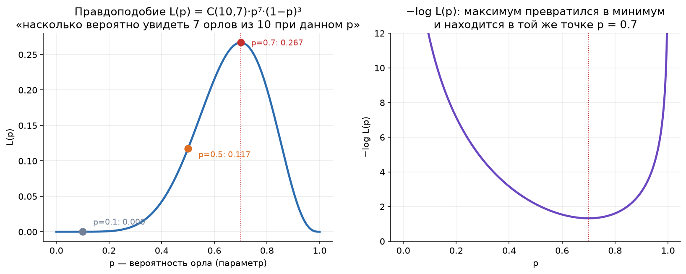

Если перебрать все $p$ (не только эти три), максимум — ровно в $p = 0.7$.

### Через производную

Логарифмируем (зачем — объясню ниже): $\log L(p) = \text{const} + 7\log p + 3\log(1-p)$.

$$\frac{d}{dp}: \quad \frac7p - \frac{3}{1-p} = 0 \ \Rightarrow\ 7(1-p) = 3p \ \Rightarrow\ \boxed{p = 0.7}$$

### Общая схема метода

`⏱ 0:19`

> **Метод максимального правдоподобия (ММП, MLE):**
> 1. Описать, как устроены данные, **вероятностной моделью** с неизвестными параметрами (монетка с параметром $p$).
> 2. Записать **правдоподобие** — вероятность увидеть наши данные как функцию от параметров.
> 3. Найти параметры, при которых правдоподобие **максимально**.

Слово «правдоподобие» отличается от «вероятности» точкой зрения: данные зафиксированы (мы их уже наблюдали), а меняются параметры.

---

## 3. Линейная регрессия как вероятностная модель → MSE

`⏱ 0:24`

### Шаг 1. Вероятностная модель

Линейную регрессию применяют, когда считают, что target зависит от признаков **примерно линейно**: $y \approx \langle w, x\rangle$. Точки не лежат ровно на прямой (вероятность этого — ноль), поэтому чтобы получить точное равенство, добавим **шум**:

$$y = \langle w, x\rangle + \varepsilon$$

Шум $\varepsilon$ — случайная величина. Предположения:
- среднее шума **0** (иначе это не шум, а систематический сдвиг);
- дисперсия **постоянна**: $\sigma^2$;
- распределение **нормальное**: $\varepsilon \sim \mathcal N(0, \sigma^2)$ — так действительно бывает в большинстве задач.

Тогда (здесь случайно только $\varepsilon$, остальное — константы):

$$y \mid x \sim \mathcal N\big(\langle w, x\rangle,\ \sigma^2\big)$$

Смысл: при данном $x$ значение $y$ «разбросано» колоколом вокруг точки на прямой.

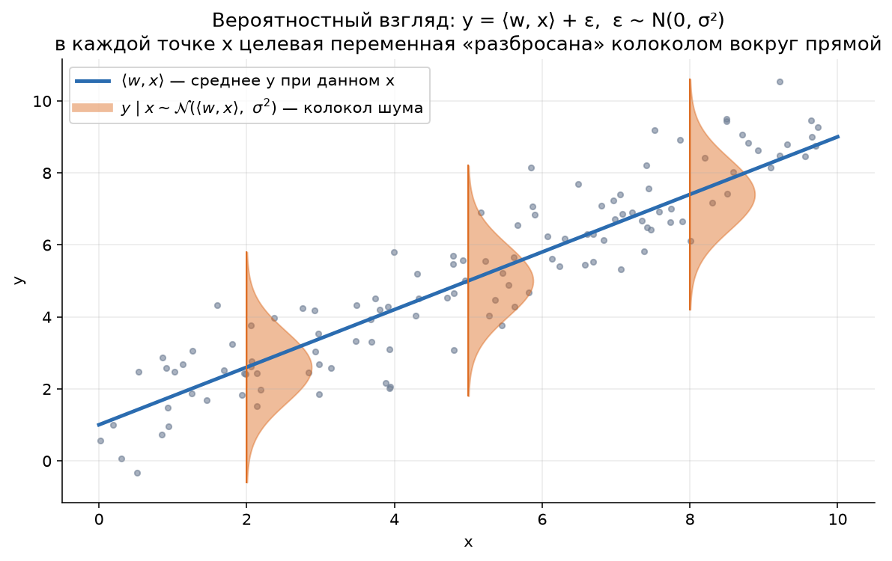

### Шаг 2. Правдоподобие выборки

`⏱ 0:29`

Для одного дома: какова вероятность (плотность) того, что он стоит 7 млн, при площади 100 м², 2 комнатах и данных весах $w$? Это $p(y_1 \mid x_1, w)$.

Для всей выборки: объекты **независимы** (дома не влияют друг на друга), поэтому вероятности **перемножаются**:

$$L(w) = p(y_1 \mid x_1, w) \cdot p(y_2 \mid x_2, w) \cdots = \prod_{i=1}^{\ell} p(y_i \mid x_i, w) \ \to\ \max_w$$

Это функция **от весов**: $x$ и $y$ даны, неизвестен только $w$. Ровно как с монеткой: подбираем параметр, при котором наблюдаемое максимально вероятно.

### Шаг 3. Подставляем плотность нормального распределения

`⏱ 0:32`

$$p(y_i \mid x_i, w) = \frac{1}{\sigma\sqrt{2\pi}}\exp\left(-\frac{(y_i - \langle w, x_i\rangle)^2}{2\sigma^2}\right)$$

$$L(w) = \prod_{i=1}^{\ell}\frac{1}{\sigma\sqrt{2\pi}}\exp\left(-\frac{(y_i - \langle w, x_i\rangle)^2}{2\sigma^2}\right)$$

Произведение экспонент — неудобно.

### Шаг 4. Логарифм и минус

`⏱ 0:34`

- **Логарифм — монотонная функция** → точка максимума не меняется.
- $\log(\text{произведения}) = \sum \log$ → произведение становится суммой.
- $\log(e^{u}) = u$ → экспоненты исчезают.
- В ML привыкли **минимизировать** → ставим минус: $\max f \Leftrightarrow \min(-f)$.

$$-\log L(w) = \sum_{i=1}^{\ell}\left[\log\left(\sigma\sqrt{2\pi}\right) + \frac{(y_i - \langle w, x_i\rangle)^2}{2\sigma^2}\right] = \underbrace{\ell\log\left(\sigma\sqrt{2\pi}\right)}_{\text{не зависит от } w} + \frac{1}{2\sigma^2}\sum_{i=1}^{\ell}\big(y_i - \langle w, x_i\rangle\big)^2$$

Константа и положительный множитель $\frac{1}{2\sigma^2}$ не влияют на то, **где** минимум. Остаётся:

$$\boxed{\ \min_w \sum_{i=1}^{\ell}\big(y_i - \langle w, x_i\rangle\big)^2\ } \quad \text{— это MSE!}$$

### Вывод (тот самый ответ Middle+)

`⏱ 0:39`

> **Почему в регрессии обычно минимизируют квадрат ошибки?** Потому что обычно предполагают, что шум в данных **нормальный**. А для нормального шума статистически обоснованный метод — максимальное правдоподобие — **в точности совпадает** с минимизацией MSE.

Не «потому что так удобно» и не «потому что гладко», а потому что это следствие предположения о шуме.

---

## 4. Когда предположения нарушаются

`⏱ 0:42`

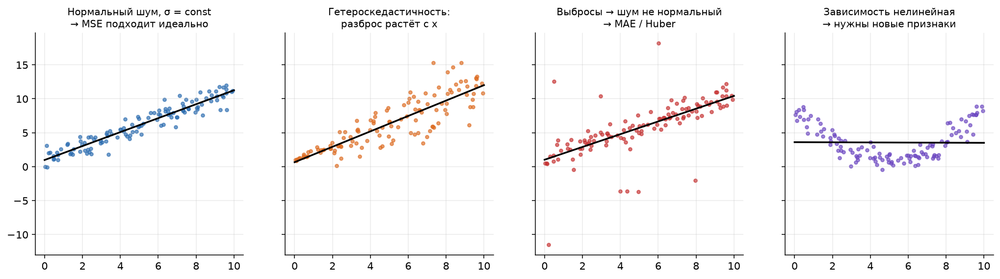

1. **Нормальный шум, постоянный разброс** — идеальный случай для MSE.
2. **Гетероскедастичность** — разброс шума меняется (здесь растёт с $x$). Это **гомоскедастичность** (постоянная дисперсия), которую мы предполагали, нарушена. Шум при этом может оставаться нормальным — просто σ не постоянная. Модель с MSE одинаково «доверяет» всем точкам, хотя справа они куда шумнее → прогнозы и особенно оценки неопределённости становятся хуже.
3. **Выбросы** — следующий раздел.
4. **Нелинейная зависимость** — линейная модель на сырых признаках не подходит, нужны новые признаки (раздел 14).

---

## 5. Тяжёлые хвосты и шум Лапласа → MAE

### Почему при нормальном шуме «выбросов не бывает»

`⏱ 0:44`

У нормального распределения доля точек дальше чем на $k\sigma$ от среднего:

| за пределами | нормальное | Лапласа (та же дисперсия) |
|---|---|---|
| ±1σ | 32% | 24% |
| ±2σ | 4.6% | 5.9% |
| ±3σ | **0.27%** | **1.4%** |
| ±4σ | **0.006%** | **0.35%** |

При нормальном шуме за 4σ практически ничего нет. Значит, если в данных **заметное количество** выбросов — это сигнал: **шум не нормальный**, и MSE (выведенная из нормальности) не подходит.

Связываем два объяснения в одно: «MSE плоха на выбросах» и «MSE ↔ нормальный шум» — это одно и то же наблюдение с двух сторон.

### Распределение Лапласа

`⏱ 0:45`

$$p(\varepsilon) = \frac{1}{2b}\exp\left(-\frac{|\varepsilon|}{b}\right)$$

Сравни с нормальным: там в показателе $\varepsilon^2$, здесь $|\varepsilon|$. Экспонента от модуля убывает **медленнее** на больших расстояниях → **тяжёлые хвосты**: далёкие значения (которые мы называем выбросами) встречаются в разы чаще.

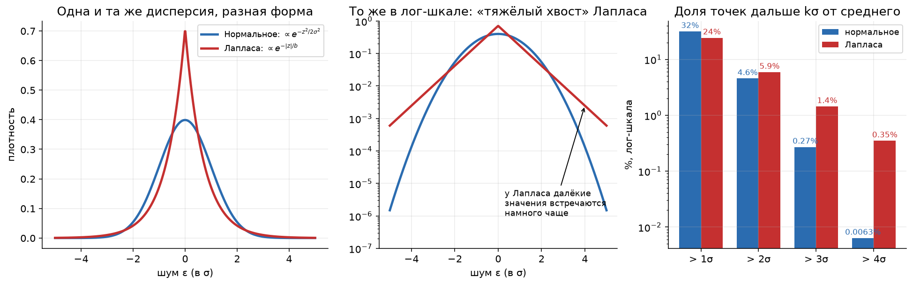

В лог-шкале (середина) видно: за 4σ у Лапласа попадает примерно в 55 раз больше точек, чем у нормального (0.35% против 0.006%), и разрыв дальше растёт.

### ММП для Лапласа

`⏱ 0:47`

Всё как в разделе 3, только другая плотность:

$$-\log L(w) = \sum_{i=1}^{\ell}\left[\log(2b) + \frac{|y_i - \langle w, x_i\rangle|}{b}\right] = \text{const} + \frac1b\sum_{i=1}^{\ell}\big|y_i - \langle w, x_i\rangle\big|$$

$$\Rightarrow\ \boxed{\ \min_w \sum_{i=1}^{\ell}\big|y_i - \langle w, x_i\rangle\big|\ } \quad \text{— это MAE!}$$

> **Выбросы в данных → шум похож на Лапласа → ММП даёт MAE.** Модель остаётся линейной регрессией (формула прогноза та же), меняется только функция потерь. `⏱ 0:50`

**Важно:** речь о **выбросах**, а не об **ошибках** в данных. Возраст 0 или −5 — ошибка, её исправляют или удаляют (лекция 1). Выброс — значение, которое выглядит возможным, но сильно не похоже на остальные.

---

## 6. Huber и общий принцип

`⏱ 0:53`

**Huber loss** — квадрат для маленьких ошибок, модуль для больших (порог $\delta$; лектор называет его σ):

$$L_\delta(z) = \begin{cases}\tfrac12 z^2, & |z| \le \delta \\ \delta\left(|z| - \tfrac12\delta\right), & |z| > \delta\end{cases}$$

**Какому шуму он соответствует?** Обратим логику: если loss = −log плотности, то плотность ∝ $e^{-\text{loss}}$. Для Huber: в центре $e^{-z^2/2}$ (нормальное), на хвостах $e^{-\delta|z|}$ (Лаплас). То есть: **маленькие ошибки нормальные, большие — как у Лапласа**.

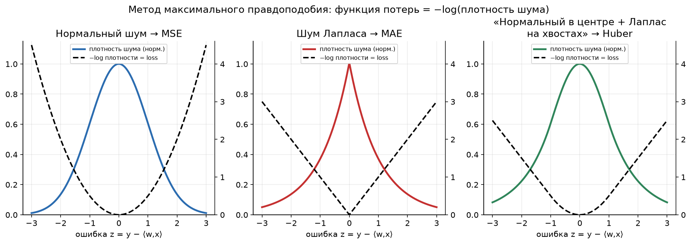

> **Общий принцип:** функция потерь = −log(плотность шума). Почти любой loss в ML выводится из ММП при каком-то предположении о данных — и в регрессии, и в классификации (логистическая регрессия), и в нейросетях. `⏱ 0:56`

Порог $\delta$ плавно сдвигает оптимальную константу от медианы (маленький $\delta$ — почти MAE) к среднему (большой $\delta$ — почти MSE):

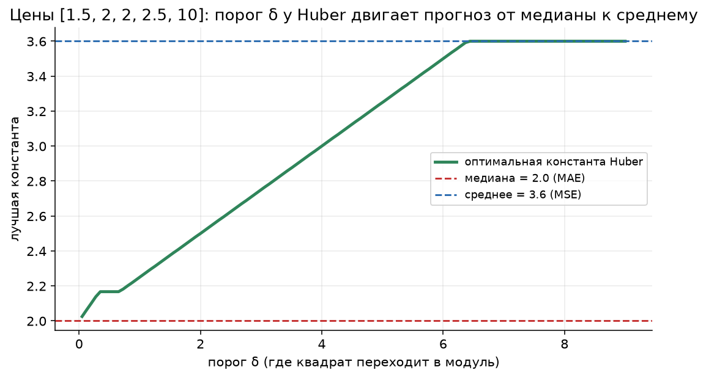

В sklearn: `LinearRegression` (MSE), `HuberRegressor` (Huber, порог `epsilon`), MAE — `QuantileRegressor(quantile=0.5)`.

---

## 7. Выброс, кластер или шум?

`⏱ 0:59`

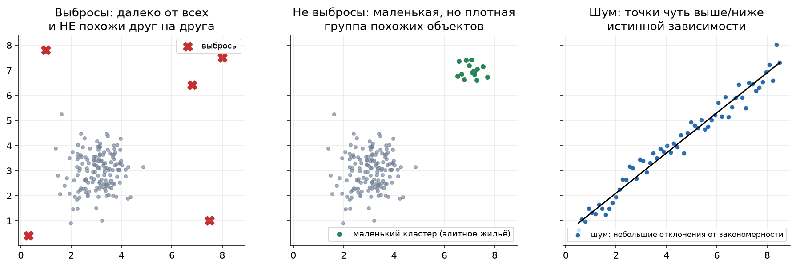

- **Выбросы** — объекты далеко от остальных **и не похожие друг на друга**. Их мало (единицы процентов).
- **Маленький кластер** — несколько **похожих** объектов вдали от основной массы (элитное жильё, богатые клиенты банка). Это **не выбросы**: у них свои, но общие для группы закономерности. На гистограмме — второй пик (бимодальность). С такими объектами работают отдельно, а не через MAE.
- **Шум** — небольшие отклонения всех точек от истинной зависимости.

> Зачем это всё на практике? `⏱ 1:28` Сам ММП в домашках считать не придётся. Он нужен, чтобы **понимать**, почему выбирают тот или иной loss.

---

# Часть 2. Метрики регрессии и практика

`⏱ 1:29`

Напоминание: **loss** минимизируем при обучении; **метрикой** оцениваем готовую модель на тесте. Метрика должна быть понятной и отражать бизнес-задачу.

## 8. MSE, RMSE, MAE и baseline

`⏱ 1:30`

| Метрика | Формула | + | − |
|---|---|---|---|
| **MSE** | $\frac1\ell\sum(y_i - a_i)^2$ | можно сравнивать модели: меньше — лучше | единицы в квадрате (₽²), не ограничена сверху → непонятно, много это или мало |
| **RMSE** | $\sqrt{\text{MSE}}$ | в единицах target | не ограничена; чувствительна к выбросам (как MSE) |
| **MAE** | $\frac1\ell\sum\lvert y_i - a_i\rvert$ | в единицах target; можно и как loss, и как метрику; устойчива к выбросам | не ограничена |

**Ошибка 1000 ₽ — много или мало?** Зависит от задачи: для чека в ресторане — огромная, для цены машины — ничтожная. RMSE/MAE нужно с чем-то сравнивать.

### Baseline — константа

`⏱ 1:34`

> **Baseline в регрессии — это константа** (например, среднее по train), а не нейросеть и не бустинг. «Сколько я слушаю защит проектов, дипломов, кандидатских…» — лектор подчёркивает, что это частая ошибка.

Сравниваем: насколько ошибка модели меньше ошибки константы. Эта идея доводится до R².

---

## 9. R² и adjusted R²

`⏱ 1:35`

$$R^2 = 1 - \frac{\sum_i (y_i - a(x_i))^2}{\sum_i (y_i - \bar y)^2} = 1 - \frac{SS_{res}}{SS_{tot}}$$

- **Числитель** — ошибка нашей модели (сумма квадратов остатков).
- **Знаменатель** — ошибка **константной модели**, которая всем предсказывает среднее $\bar y$ (это же, с точностью до деления на $\ell$, дисперсия $y$).

R² — это «на сколько модель лучше константы». Из ошибки получилась **мера качества** (больше — лучше).

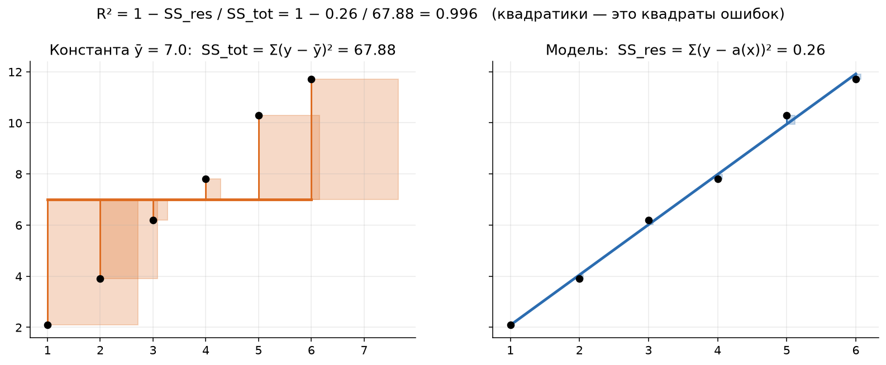

Квадратики на картинке — буквально квадраты ошибок. R² = 1 − (площадь синих квадратиков) / (площадь оранжевых).

✍️ **Руками:** $y = (2, 4, 6)$, $a = (3, 4, 5)$. $\bar y = 4$.
$SS_{tot} = 4 + 0 + 4 = 8$, $SS_{res} = 1 + 0 + 1 = 2$, $R^2 = 1 - 2/8 = 0.75$.

### Какие значения принимает R²

`⏱ 1:37`

- **Идеальная модель** ($a = y$): $SS_{res} = 0$ → $R^2 = 1$. Больше быть не может.
- **Модель = среднее**: числитель = знаменателю → $R^2 = 0$.
- **Хуже среднего**: числитель больше знаменателя → $R^2 < 0$, и **сколь угодно** отрицательный (числитель не ограничен). Несмотря на «квадрат» в названии — это просто историческое имя.

Итак, $R^2 \in (-\infty, 1]$.

**Интерпретация:** `⏱ 1:40`
- $R^2 < 0$ — плохая модель без оправданий, хуже константы;
- $R^2 \ge 0.8$ — эмпирически хорошо для большинства задач;
- но порог зависит от задачи: для физических расчётов (самолёты) нужно ≈1, а в социологии и маленький положительный R² — уже результат.

**Почему R² любят:** по нему не нужно помнить, о чём были данные. «Полгода назад R² был 0.85» — понятно, что модель неплохая. «MAE была 15 000» — без контекста ничего не говорит.

### Adjusted R²

`⏱ 1:42`

На **обучающей** выборке R² **не уменьшается** при добавлении признаков: в худшем случае модель поставит новым признакам нулевые веса, а может чуть подогнаться под шум. Значит, честно сравнивать R² моделей с разным числом признаков нельзя. Поправка:

$$R^2_{adj} = 1 - (1 - R^2)\cdot\frac{\ell - 1}{\ell - n - 1}$$

$\ell$ — объектов, $n$ — признаков.

✍️ $R^2 = 0.80$, $n = 10$:
- $\ell = 100$: $R^2_{adj} = 1 - 0.2 \cdot 99/89 \approx 0.778$ — заметная поправка;
- $\ell = 10\,000$: $R^2_{adj} \approx 0.7998$ — почти ничего.

Поэтому в ML с большими выборками обычно считают простой R², и это допустимо.

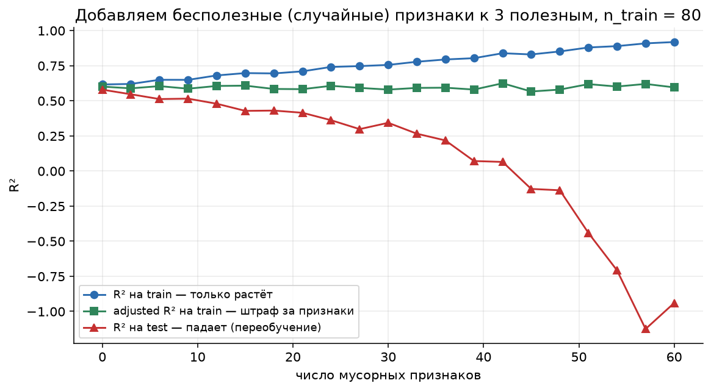

Эксперимент: к 3 полезным признакам добавляем случайные. **Train R²** растёт, **adjusted R²** почти не растёт, а **test R²** падает — модель подгоняется под шум.

> ⚠️ «R² может только вырасти» — верно **для train**. На тесте лишние признаки R² **уменьшают**.

**Итого:** MSE, RMSE, R² — по сути одна семья (все про квадратичную ошибку). MAE — отдельное направление. `⏱ 1:46`

---

## 10. Относительные метрики: MSLE, MAPE, SMAPE, WAPE

### MSLE — ошибка «по порядку величины»

`⏱ 1:46`

$$\text{MSLE} = \frac1\ell\sum_{i}\big(\log(a_i + 1) - \log(y_i + 1)\big)^2, \qquad \text{RMSLE} = \sqrt{\text{MSLE}}$$

Это MSE, но между **логарифмами** прогноза и факта.

**Зачем:** иногда важна **относительная** ошибка. 10 млн vs 10.1 млн — по смыслу почти точно, хотя в рублях разница 100 000. 10 млн vs 20 млн — уже серьёзно, 10 vs 100 млн — совсем плохо. Логарифм сравнивает именно **масштабы**: $\log a - \log y = \log\frac{a}{y}$ — по сути отношение.

**+1** — чтобы не было $\log 0$. **Только для $y \ge 0$** (логарифм отрицательных не считается).

**Несимметрична** `⏱ 1:50`: при факте 100 прогноз 50 → штраф ≈ **0.47**, прогноз 150 → ≈ **0.16**. Занижение наказывается почти в 3 раза сильнее. (В записи слышится «0,07» вместо 0.47; на слайде число верное.)

### MAPE — средняя абсолютная процентная ошибка

`⏱ 1:51`

$$\text{MAPE} = \frac1\ell\sum_{i}\frac{|y_i - a_i|}{|y_i|}$$

MAE, где каждая ошибка поделена на факт. MAPE = 0.16 → «в среднем ошибаемся на 16% от факта» — понятно менеджеру.

**Проблемы:**
1. **Не ограничена сверху**: при перепрогнозе можно ошибиться на 500%.
2. **Нули и маленькие $y$**: деление на 0 или почти 0 → огромные числа.
3. **Несимметрична** `⏱ 1:54`: прогноз 20, факт 10 (перепрогноз на 10) → **100%**; прогноз 20, факт 30 (недопрогноз на 10) → **33%**.

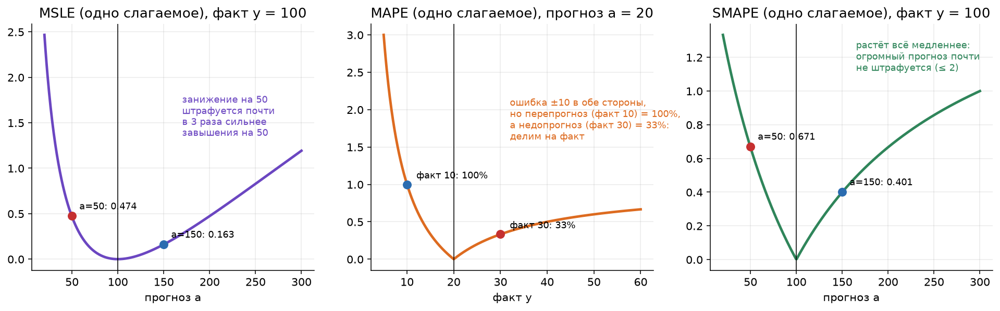

### SMAPE — попытка симметризовать

`⏱ 1:55`

$$\text{SMAPE} = \frac1\ell\sum_i\frac{|y_i - a_i|}{(|y_i| + |a_i|)/2}$$

Популярна во временных рядах. Делает метрику *более* симметричной, но не полностью. Главная беда — **прогноз в знаменателе**: завышение штрафуется слабее такого же занижения (факт 100: прогноз 150 → 0.40, прогноз 50 → 0.67), поэтому модели выгодно завышать. Если прогноз уже выше факта, дальнейшее завышение ошибку всё же увеличивает, но всё медленнее. Ограничена значением 2 (на графике справа: огромный прогноз почти не штрафуется дополнительно). **Лектор не рекомендует.**

### WAPE — взвешенная процентная ошибка

`⏱ 1:57`

$$\text{WAPE} = \frac{\sum_i |y_i - a_i|}{\sum_i |y_i|}$$

Найди отличие от MAPE: там процент считается **для каждого объекта** и усредняется; здесь — **суммарная** ошибка делится на **суммарный** факт. Деление на 0 почти не грозит (только если **все** $y = 0$).

✍️ **Руками** — почему это важно: $y = (10, 100)$, $a = (20, 110)$ (ошиблись на 10 оба раза).
- MAPE $= \frac12\left(\frac{10}{10} + \frac{10}{100}\right) = \frac{1.0 + 0.1}{2} = 55\%$ — маленький объект «взорвал» метрику.
- WAPE $= \frac{10 + 10}{10 + 100} = 18\%$.

Недостаток WAPE: крупные объекты (популярные товары) доминируют в ошибке, а редкие почти не влияют.

### Другие метрики

`⏱ 2:00`

- **Максимальная ошибка** — «насколько ошибаемся в худшем случае». Пример: гарантия, что клопы не вернутся год, — нужна оценка не в среднем, а по худшему случаю. Шумная (всегда ловит выбросы) → лучше **95%-квантиль** ошибок.
- **Квантильная** функция потерь (лекция 2) тоже годится как метрика.
- **Своя метрика** под бизнес-задачу — нормально (в первой домашке придётся придумать).

---

## 11. Как выбрать метрику

`⏱ 2:02`

> **Не считайте 10 метрик «на всякий случай».** Выберите **одну ведущую** (и, может, 1–2 вспомогательных) и **обоснуйте** выбор.

Почему: метрики **не синхронизированы** — одна растёт, другая падает. Если вам важны обе и они разошлись, вы не можете сказать, стала ли модель лучше. Ведущая метрика должна отражать **практический запрос**.

**Что учесть при выборе:**
- может ли target быть отрицательным (MSLE — нет);
- важна ли относительная или абсолютная ошибка;
- одинаково ли плохи перепрогноз и недопрогноз (если нет — симметричные MSE/MAE не подходят);
- есть ли выбросы (MSE/RMSE будут на них ориентироваться);
- есть ли нули в target (MAPE сломается).

---

## 12. Семинар: от сырых данных до модели

`⏱ 2:06` · ноутбук `Week2_Regression/LinReg_pipeline.ipynb`

**Датасет:** UCI Automobile — 205 машин, 25 признаков (марка, тип топлива, привод, размеры, объём двигателя, мощность, расход…). **Target — цена.** Регрессия.

### Шаг 1. Пропуски в целевой переменной

`⏱ 2:07`

Пропуски в target **не заполняем** — на таких строках нечему учиться. 4 строки удаляем → 201 машина.

### Шаг 2. Минимум, который нужно сделать с данными

`⏱ 2:08`

1. **Заполнить пропуски** в признаках.
2. **Закодировать категориальные** признаки (модель ждёт числа).
3. **Масштабировать** (признаки в сотнях, единицах, тысячах).
4. (По-хорошему ещё найти ошибки.)

### Шаг 3. Пропуски

`⏱ 2:09`

```python
cat_mask = ~X.dtypes.apply(pd.api.types.is_numeric_dtype)
X_real = SimpleImputer(strategy="mean").fit_transform(X.loc[:, ~cat_mask])  # числа → среднее
X_cat = X.loc[:, cat_mask].fillna("NA")                                       # категории → своя категория
```

- **Числовые** — средним (лектор оговаривается: медиана безопаснее — среднее тянется к выбросам).
- **Категориальные** — отдельной категорией `"NA"`. Сам факт пропуска может быть информативным.

### Отступление: экономия памяти

`⏱ 2:11`

| Шаг | Память |
|---|---|
| исходно (`float64` + `object`) | 128 КБ |
| строки → `category` | 30 КБ |
| числа → `pd.to_numeric(..., downcast=...)` | 19 КБ |

**В ~7 раз меньше без потери информации.** `float64` (64 бита на число) часто избыточен; `object` хранит каждую строку целиком, а `category` — словарь категорий + маленькие коды. На гигабайтных данных это критично.

### Шаг 4. Категории и one-hot

`⏱ 2:15`

22 марки, 2 типа топлива, 3 варианта числа дверей… Стоит проверить категории на опечатки (лектор приводит `drive-wheels` как пример, но там значения `rwd`/`fwd`/`4wd` — задний, передний и полный привод, всё корректно).

```python
X_dum = pd.get_dummies(X_no_mis, drop_first=True)   # 201 × 65
```

`drop_first=True` — на один столбец меньше на каждый признак, чтобы избежать dummy trap (лекция 2). Булевы столбцы sklearn понимает как 0/1.

### Шаг 5. Масштабирование

`⏱ 2:18`

```python
X = MinMaxScaler().fit_transform(X_dum)   # всё в [0, 1]
```

Какой скейлер — обычно не принципиально. Но с one-hot удобен **MinMaxScaler**: столбцы из 0/1 так и останутся 0/1. `⏱ 2:21`

### Шаг 6. Обучение и сравнение с baseline

`⏱ 2:21`

```python
Xtr, Xte, ytr, yte = train_test_split(X, y, test_size=0.25, random_state=123)
const = DummyRegressor(strategy="mean").fit(Xtr, ytr)   # baseline
lr = LinearRegression().fit(Xtr, ytr)
```

Результаты (воспроизведены):

| | R² train | R² test | RMSE test | MAE test | MAPE test |
|---|---|---|---|---|---|
| константа | 0.000 | **−0.314** | 6806 | 5315 | 58% |
| LinearRegression | **0.976** | **0.772** | 2835 | 1974 | 19% |

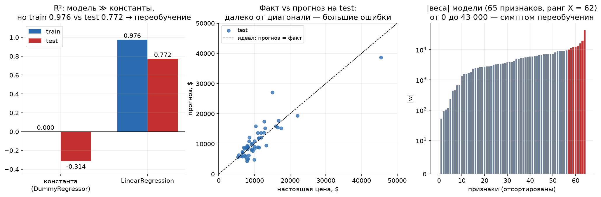

- **Модель намного лучше константы** — хорошо.
- **R² константы на тесте отрицательный.** Не странно: константа = среднее **train**, а у test своё среднее; «идеальная» константа для test дала бы R² = 0, наша — хуже.
- **Факт vs прогноз** (в центре): большинство точек у диагонали, но есть большие промахи (машина за $15k с прогнозом почти $30k). Такая картинка — дополнение к метрикам и подсказка, где искать выбросы.
- (Здесь посчитаны все метрики, чтобы показать, что они есть в `sklearn.metrics`. В проекте так **не надо** — нужна одна ведущая.)

---

## 13. Переобучение

`⏱ 2:24`

Train R² **0.976** (почти идеально), test R² **0.772** — сильный разрыв. Это **переобучение**: модель излишне подогналась под обучающие данные, отчасти **запомнила** их, вместо того чтобы выучить истинные закономерности.

**Как отличить от «просто плохой модели»?** `⏱ 2:33` Ключ — качество **на train**. Если на train почти идеал, а на test заметно хуже — переобучение. Если на train тоже посредственно (0.8 vs 0.7) — проблема может быть в другом (модель слишком простая, признаки слабые).

**Ещё симптомы:**
- **Огромные веса** `⏱ 2:29`: |w| от 0 до **43 000** (на графике справа). Когда одни веса крошечные, а другие гигантские, модель, скорее всего, переобучилась.
- **Ранг матрицы признаков меньше числа столбцов** `⏱ 2:30` (60 из 65 на обучающей части; у полной матрицы 62): даже после `drop_first` в признаках осталась линейная зависимость → плохая обусловленность → большие нестабильные веса (лекция 2, раздел про мультиколлинеарность).

Лечение — **регуляризация** (следующая неделя).

---

## 14. Feature engineering

`⏱ 2:35`

Базовые шаги сделаны. Что дальше, если качества мало? **Придумывать новые признаки.**

### Игрушечный пример

`⏱ 2:36`

Истина: $y = 2x_1 + 3x_2^2 + \text{шум}$. От $x_1$ — линейно, от $x_2$ — парабола.

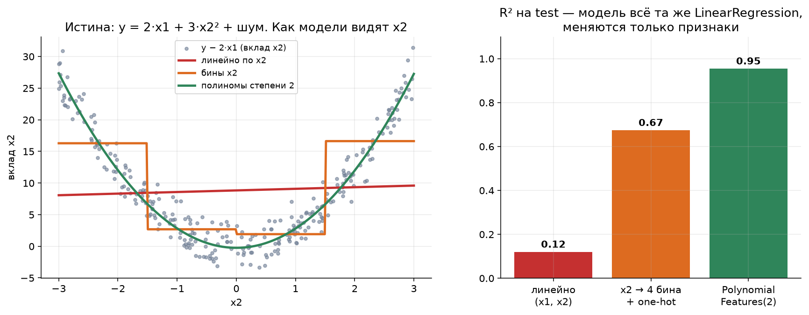

| Признаки | R² test | Что произошло |
|---|---|---|
| $x_1, x_2$ как есть | 0.12 | прямая не ловит параболу |
| $x_1$ + бины $x_2$ (one-hot) | 0.67 | ступеньки приближают параболу |
| `PolynomialFeatures(2)`: $x_1, x_2, x_1^2, x_1x_2, x_2^2$ | **0.95** | модель нашла, что главный признак — $x_2^2$ |

(У лектора на её данных: 0.25 → 0.75 → 0.99 — та же картина.)

**`PolynomialFeatures(degree=2)`** добавляет все произведения признаков до степени 2: $x_1^2,\ x_1x_2,\ x_2^2$. «Из пушки по воробьям»: накидываем много и надеемся, что модель сама выберет полезные. Опасно: при многих признаках их число взрывается, растёт риск переобучения.

> Модель от этого **не становится нелинейной** `⏱ 2:42` — она линейна по весам (лекция 2). Нелинейными становятся признаки.

### На реальных данных

`⏱ 2:42`

Лучше не «вслепую», а **порисовать зависимости** target от каждого признака и подобрать преобразование:
- цена от объёма двигателя и мощности растёт **быстрее линейной** → добавить $x^2$;
- цена от расхода топлива (`city-mpg`) похожа на **обратную** зависимость → $1/x$ или бины по квантилям.

С ручными признаками test R² вырос **0.77 → 0.86**.

---

## 15. Pipeline и утечка данных

### Проблема: ручной код

`⏱ 2:44`

Чтобы всё сделать честно, каждое преобразование, которое что-то **вычисляет по данным**, должно вычислять это **только по train**:

- средние / медианы для заполнения пропусков,
- min / max или mean / std для скейлера,
- квантили для бинов,
- список категорий для one-hot.

А к test — только **применять** уже посчитанное. Иначе информация из test «утекает» в обучение — это **data leakage (утечка данных)**, и оценка качества на test получается **завышенной**.

Вручную это превращается в нечитаемый код: «отдельно fit на train, отдельно transform train, отдельно transform test» для каждого шага. Легко перепутать.

### Решение: Pipeline

`⏱ 2:47`

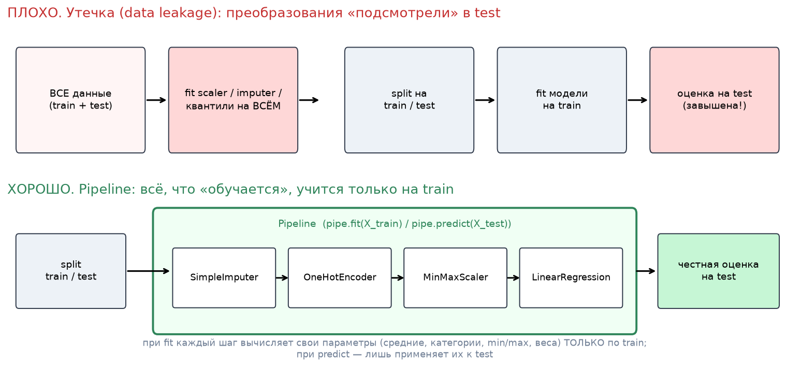

**Pipeline** — цепочка шагов, у которой есть единые `fit` и `predict`:

```python
from sklearn.pipeline import make_pipeline
pipe = make_pipeline(PolynomialFeatures(2), StandardScaler(), LinearRegression())
pipe.fit(X_train, y_train)    # КАЖДЫЙ шаг учится только на train
pipe.predict(X_test)          # к test шаги только применяются
```

Для разных типов колонок — **ColumnTransformer** (свой подпайплайн на каждую группу):

```python
num = Pipeline([("impute", SimpleImputer(strategy="mean")), ("scale", StandardScaler())])
poly = Pipeline([("impute", SimpleImputer()), ("poly", PolynomialFeatures(2)), ("scale", StandardScaler())])
cat = Pipeline([("impute", SimpleImputer(strategy="constant", fill_value="NA")),
                ("ohe", OneHotEncoder(drop="first", handle_unknown="ignore"))])

pre = ColumnTransformer([("num", num, num_cols), ("poly", poly, poly_cols), ("cat", cat, cat_cols)])
model = Pipeline([("pre", pre), ("lr", LinearRegression())])

model.fit(X_train, y_train)
cross_val_score(model, X, y, cv=5)   # пайплайн целиком можно отдать в кросс-валидацию!
```

**Плюсы:**
- гарантированно нет утечки — всё учится на train;
- код читается как рецепт, «собирается из кубиков», легко искать ошибки;
- пайплайн целиком передаётся в `cross_val_score` (тогда на каждом фолде все шаги переобучаются заново — тоже без утечки);
- в проде это один объект: сырые данные на входе → прогноз на выходе.

С пайплайном качество вышло **чуть ниже**, чем с ручным кодом. Это ожидаемо: пайплайн честнее.

> ⚠️ Лектор говорит «зато мы точно не переобучились». Точнее: **точно нет утечки** — оценка на test честная. **Переобучение** (train ≫ test) — отдельная проблема, пайплайн её не лечит.

**Насколько страшно масштабировать всё вместе?** `⏱ 2:54` Обычно утечка от скейлера небольшая, но лучше делать правильно с самого начала.

**Просьба лектора:** используйте пайплайны в своих задачах, даже простые — «one-hot → scaler → модель».

---

## 16. Итог в одной таблице

| Тема | Суть одной фразой |
|---|---|
| ММП | Параметры, при которых наблюдаемые данные максимально вероятны |
| Монетка 7/10 | $\hat p = 0.7$ — максимум $C_{10}^7 p^7(1-p)^3$ |
| −log L | Произведение → сумма, max → min, точка оптимума та же |
| $y = \langle w,x\rangle + \varepsilon$ | Линейная регрессия как вероятностная модель |
| Нормальный шум | ММП ⇔ MSE (ответ «почему квадрат») |
| Шум Лапласа | Тяжёлые хвосты, ММП ⇔ MAE |
| Huber | Нормальный в центре + Лаплас на хвостах |
| Loss = −log p(шума) | Общий принцип для регрессии, классификации, нейросетей |
| Гетероскедастичность | Непостоянная дисперсия шума — предположение нарушено |
| Выброс vs кластер | Выбросы не похожи и друг на друга; плотная группа — не выбросы |
| RMSE / MAE | В единицах target, не ограничены, нужен контекст |
| Baseline | Константа (`DummyRegressor`) |
| R² | $1 - SS_{res}/SS_{tot}$, $(-\infty, 1]$; 0 = как среднее |
| Adjusted R² | Штраф за число признаков; важен при малом $\ell$ |
| MSLE | Ошибка по порядку величины, $y \ge 0$, занижение штрафуется сильнее |
| MAPE | % от факта; нули, несимметрия, не ограничена |
| SMAPE | Не рекомендуется: завышение штрафуется слабее занижения |
| WAPE | Сумма ошибок / сумма фактов — устойчивее MAPE |
| Ведущая метрика | Одна, обоснованная бизнес-запросом |
| Переобучение | Train ≫ test; симптомы — огромные веса, ранг < числа признаков |
| Feature engineering | Бины, $x^2$, $1/x$, `PolynomialFeatures` — модель остаётся линейной |
| Data leakage | Статистики посчитаны с участием test → завышенная оценка |
| Pipeline | fit на train / predict на test для всех шагов; работает с CV |
