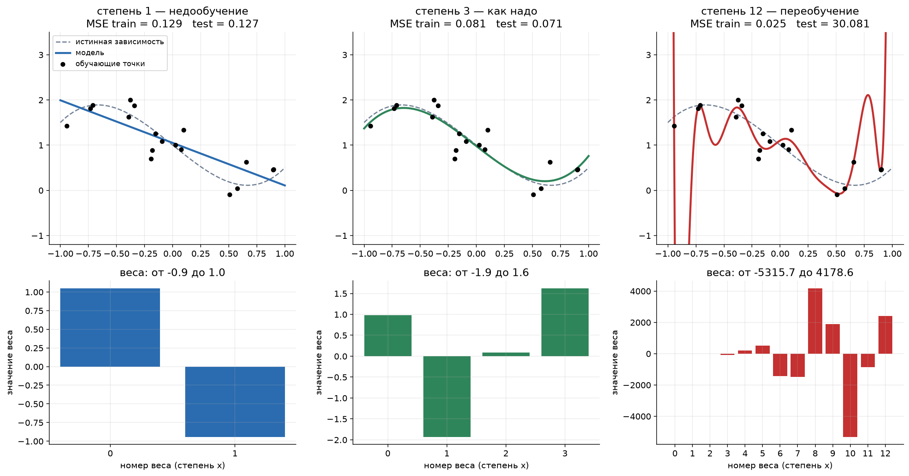
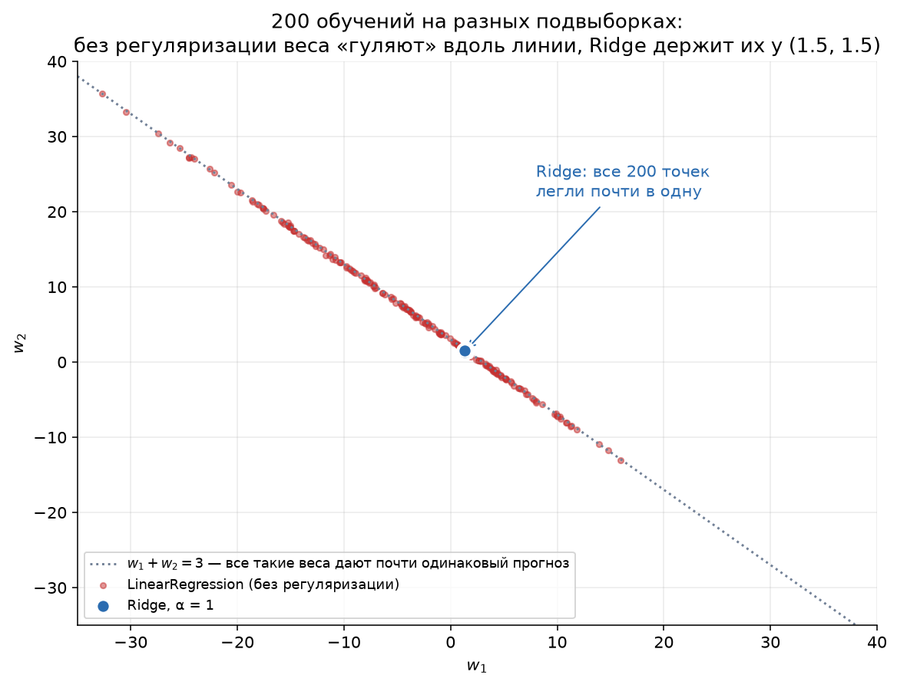
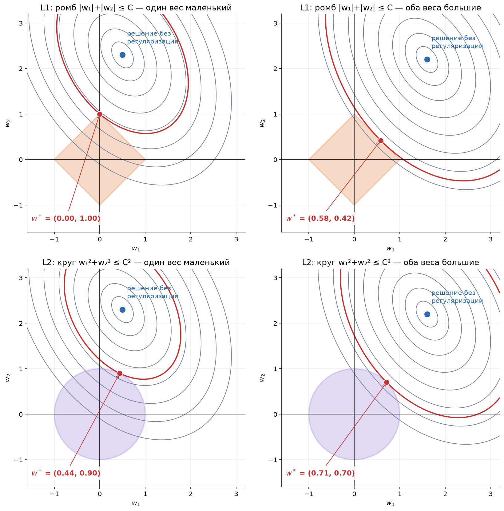
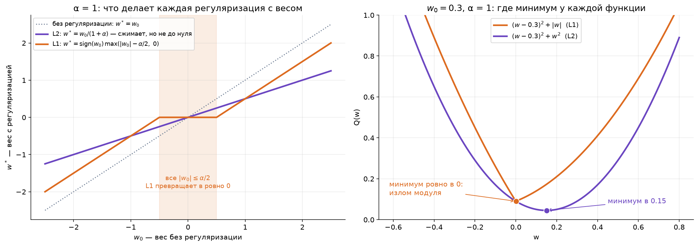
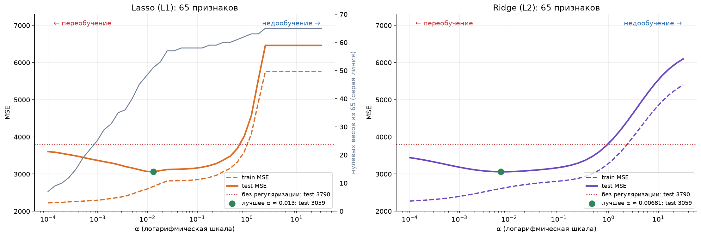
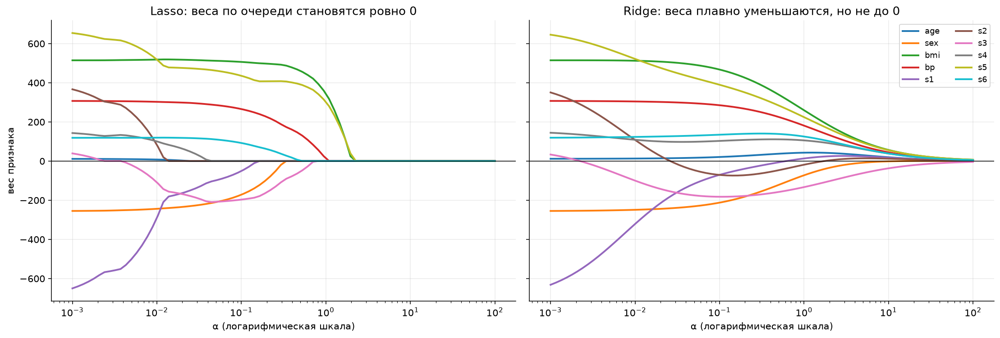
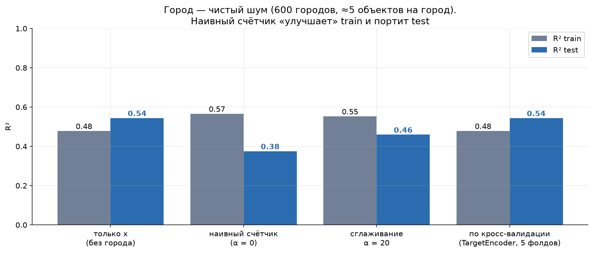
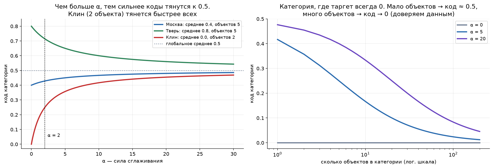
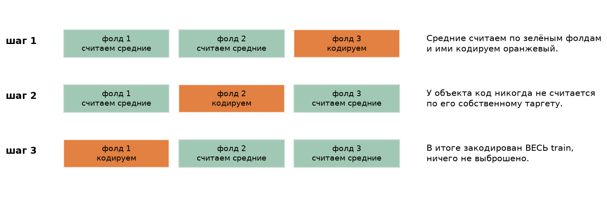

# Лекция 4 — расширенный конспект

**Часть 1: переобучение и регуляризация (L1, L2, гиперпараметры). Часть 2: кодирование категориальных признаков (one-hot, счётчики)**

> Этот файл можно читать **вместо просмотра лекции**. Краткая версия с картой и самопроверкой — [lecture_04.md](lecture_04.md).
> `⏱ 0:24` — где смотреть в записи. В записи только **базовая пара** (1:34); продвинутая шла отдельной встречей.
> Графики строит [scripts/lecture_04_plots.py](scripts/lecture_04_plots.py). Числа семинара воспроизведены на **тех же данных и с тем же разбиением**, что в `Week3_GD_Features/Regularization_and_Encoding_Base.ipynb`.

## Содержание

**Часть 1. Переобучение и регуляризация**
1. [Недообучение и переобучение](#1-недообучение-и-переобучение)
2. [Почему большие веса — симптом переобучения](#2-почему-большие-веса--симптом-переобучения)
3. [Регуляризация: штраф за большие веса](#3-регуляризация-штраф-за-большие-веса)
4. [Ridge решает проблему линейной зависимости](#4-ridge-решает-проблему-линейной-зависимости)
5. [Почему L1 зануляет веса, а L2 — нет](#5-почему-l1-зануляет-веса-а-l2--нет)
6. [Семинар: регуляризация на данных о диабете](#6-семинар-регуляризация-на-данных-о-диабете)
7. [Гиперпараметры и GridSearchCV](#7-гиперпараметры-и-gridsearchcv)

**Часть 2. Кодирование категориальных признаков**

8. [One-hot и его главный минус](#8-one-hot-и-его-главный-минус)
9. [Счётчики (mean target encoding)](#9-счётчики-mean-target-encoding)
10. [Главная опасность: утечка таргета](#10-главная-опасность-утечка-таргета)
11. [Лечение 1: сглаживание](#11-лечение-1-сглаживание)
12. [Лечение 2: считать по другим частям данных](#12-лечение-2-считать-по-другим-частям-данных)
13. [Семинар: бриллианты, one-hot против счётчиков](#13-семинар-бриллианты-one-hot-против-счётчиков)
14. [Итог в одной таблице](#14-итог-в-одной-таблице)

---

# Часть 1. Переобучение и регуляризация

## 1. Недообучение и переобучение

`⏱ 0:11`

Задача обучения — чтобы модель выучила **закономерность**, по которой таргет получается из признаков. Ошибиться можно в обе стороны.

- **Недообучение (underfitting):** модель **проще** закономерности. Например, прямая там, где зависимость изогнутая. Плохо и на train, и на test.
- **Переобучение (overfitting):** модель **слишком гибкая** и подогналась под шум обучающих данных. На train отлично, на test заметно хуже.

На практике чаще встречается переобучение: «переусложнить легче, чем недоусложнить» `⏱ 0:13`.

**Как ловить** `⏱ 0:13`: обучаем на train, считаем метрику и на train, и на test.

| Train | Test | Диагноз |
|---|---|---|
| хорошо | примерно так же хорошо | всё в порядке |
| плохо | плохо | недообучение |
| очень хорошо | заметно хуже | **переобучение** |

Пример со слайдов 6–7 я воспроизвёл сам: загадал кубическую зависимость $y = 1.5x^3 - 2x + 1$, добавил шум и взял всего 18 обучающих точек.



| Степень полинома | MSE train | MSE test | Веса |
|---|---|---|---|
| 1 (прямая) | 0.129 | 0.127 | от −0.9 до 1.0 |
| 3 (как загадано) | 0.081 | **0.071** | от −1.9 до 1.6 |
| 12 | **0.025** | 30.1 | от −5316 до 4179 |

У полинома 12-й степени ошибка на train самая маленькая: кривая почти проходит через точки. Но между точками она делает дикие петли, и на новых данных ошибка в 400 раз больше. Посмотри и на **веса**: тысячи, с разными знаками. Это второй симптом, о нём следующий раздел.

У полинома 3-й степени веса $(0.98,\ -1.94,\ 0.08,\ 1.60)$ при $1, x, x^2, x^3$. Это почти те $(1,\ -2,\ 0,\ 1.5)$, которые я загадал.

---

## 2. Почему большие веса — симптом переобучения

`⏱ 0:14`

Слайд 5 называет три признака переобученной модели:
1. большой разрыв качества между train и test;
2. **большие веса** $w_j$, часто разных знаков;
3. неустойчивость: маленькое изменение данных сильно меняет модель.

Почему пункт 2? Лектор дала два объяснения.

### Объяснение на пальцах

`⏱ 0:15`

Цена квартиры $= \ldots + 1\,000\,000\,000 \cdot \text{площадь} + \ldots$ Площадь выросла на 1 м², всё остальное то же, а цена выросла на **миллиард**. Так не бывает. Небольшое изменение признака должно давать небольшое изменение прогноза. Огромный вес значит, что модель реагирует на мелочи, то есть подогналась под шум.

⚠️ Сравнивать веса можно только **после масштабирования** признаков `⏱ 0:21`. Если площадь в км², вес будет огромным просто из-за единиц измерения.

### Объяснение через линейную зависимость

`⏱ 0:16`

Признаки **линейно зависимы**, если есть ненулевой вектор коэффициентов $v$, с которым

$$\langle v, x\rangle = v_1 x_1 + v_2 x_2 + \ldots + v_d x_d = 0 \quad \text{для каждого объекта.}$$

Прогноз линейной модели — $\langle w, x\rangle$. Прибавим к весам $\alpha v$ с **любым** числом $\alpha$:

$$\langle w + \alpha v,\ x\rangle = \langle w, x\rangle + \alpha\underbrace{\langle v, x\rangle}_{=\,0} = \langle w, x\rangle.$$

Прогноз **не изменился**, а веса изменились как угодно сильно. Значит, оптимальных весов бесконечно много (слайд 8, утверждение 2), среди них есть сколь угодно большие, и модель может выбрать любые.

✍️ **Руками.** Пусть третий признак — сумма первых двух: $x_3 = x_1 + x_2$. Тогда $v = (1,\ 1,\ -1)$, ведь $x_1 + x_2 - x_3 = 0$. Возьмём объект $x = (2,\ 3,\ 5)$:

| Веса $w$ | Прогноз $\langle w, x\rangle$ |
|---|---|
| $(1,\ 2,\ 0)$ | $2 + 6 + 0 = 8$ |
| $(1,\ 2,\ 0) + 5\cdot(1,\ 1,\ -1) = (6,\ 7,\ -5)$ | $12 + 21 - 25 = 8$ |
| $(1,\ 2,\ 0) + 1000\cdot(1,\ 1,\ -1) = (1001,\ 1002,\ -1000)$ | $2002 + 3006 - 5000 = 8$ |

Прогноз один и тот же, а веса огромные и разных знаков — ровно та картина, что у переобученной модели.

**Почти** линейная зависимость тоже плоха `⏱ 0:17`. Решение формально одно, но малейшее изменение данных сильно его сдвигает. Я проверил на двух почти одинаковых признаках (корреляция 0.9998), где на самом деле важен только первый. Модель обучена 200 раз на случайных подвыборках:



Без регуляризации $w_1$ прыгает от −33 до +16, но сумма $w_1 + w_2 \approx 3$ держится: прогноз почти не меняется, меняется только то, как вес поделён между близнецами. Ridge (раздел 4) кладёт все 200 решений в одну точку около $(1.4,\ 1.5)$.

> **🧩 Пример прямо из семинара.** В данных о диабете признак `sex` принимает всего два значения ($-0.0446$ и $0.0507$). Поэтому его квадрат точно выражается через него самого:
> $$\text{sex}^2 = 0.002262 + 0.006038\cdot\text{sex}.$$
> Когда на семинаре добавили все квадраты и попарные произведения, столбец `sex_x_sex` оказался линейно зависим от `sex` и свободного члена: ранг матрицы вместе со столбцом единиц — 65 из 66. Это частый случай: **квадрат бинарного признака** — всегда линейная функция от него.

**Связь с формулой МНК.** Веса линейной регрессии считаются аналитически `⏱ 0:17`:

$$w = (X^TX)^{-1}X^Ty.$$

При линейной зависимости $\det(X^TX) = 0$, обратной матрицы нет. При почти зависимости определитель почти ноль, и при обращении мы «делим на почти ноль». Отсюда огромные веса. Студент в чате сформулировал это через маленькие сингулярные числа, лектор подтвердила `⏱ 0:21`: это одно и то же.

> **🧩 Как sklearn обучается, если обратной матрицы нет.** `LinearRegression` не обращает $X^TX$, а решает задачу методом наименьших квадратов через псевдообратную матрицу. При точной зависимости он молча выбирает одно решение из бесконечного множества (с наименьшей длиной вектора весов). Поэтому на семинаре лекции 3 модель обучилась, хотя ранг был 60 из 65. Ошибки нет, но веса интерпретировать нельзя.

**Почему бы просто не удалить зависимые признаки?** `⏱ 0:25` Если нашли точную зависимость — удаляйте. Но в реальных данных зависимость обычно **почти** точная, и найти её трудно. А причин больших весов бывает много `⏱ 0:30`. Поэтому лечат симптом: запрещают весам быть большими.

---

## 3. Регуляризация: штраф за большие веса

`⏱ 0:23`

Идея: к функции потерь $Q(w)$ (MSE, MAE — любой) прибавляем **штраф за размер весов** $R(w)$:

$$Q_\alpha(w) = Q(w) + \alpha\cdot R(w) \to \min_w$$

Два самых популярных штрафа (слайд 10):

$$\text{L2:}\quad R(w) = \|w\|_2^2 = \sum_{j=1}^{d} w_j^2 \qquad\qquad \text{L1:}\quad R(w) = \|w\|_1 = \sum_{j=1}^{d} |w_j|$$

Например, MSE с L2-регуляризацией (слайд 11):

$$Q_\alpha(w) = \frac1\ell\sum_{i=1}^{\ell}\big(\langle w, x_i\rangle - y_i\big)^2 + \alpha\sum_{j=1}^{d} w_j^2$$

**Как это работает** `⏱ 0:27`. Минимизируем **сумму**. Первое слагаемое тянет веса туда, где ошибка на train мала. Второе тянет их к нулю. В итоге веса получаются **меньше**, чем без штрафа, а с ними меньше и переобучение. Модель вынуждена объяснять данные «дёшево», без огромных коэффициентов.

**$\alpha$ — коэффициент регуляризации** `⏱ 0:28`. Его выбираем мы, а не модель:
- $\alpha = 0$ — штрафа нет, обычная регрессия;
- маленькое $\alpha$ — штраф почти не влияет;
- большое $\alpha$ — модель больше заботится о маленьких весах, чем о точности. При $\alpha \to \infty$ все веса $\to 0$, и прогноз превращается в константу.

**Свободный член $w_0$ не штрафуем** `⏱ 0:29`: сумма в штрафе идёт с $j = 1$. Свободный член отвечает за общий уровень прогноза. Если сжать и его, модель не сможет предсказывать, например, цены около миллиона при маленьких признаках. В sklearn это учтено автоматически: `intercept_` не регуляризуется.

Регуляризация работает с **любой** функцией потерь `⏱ 0:35`: MSE, MAE, Huber, а позже — логистической. В sklearn названия закреплены за конкретными сочетаниями `⏱ 1:15`:
- `Lasso` = MSE + L1 (по-английски LASSO);
- `Ridge` = MSE + L2 («гребневая регрессия»).

---

## 4. Ridge решает проблему линейной зависимости

`⏱ 0:31`

Для MSE + L2 тоже есть формула (слайд 12):

$$w = (X^TX + \alpha I)^{-1}X^Ty,$$

где $I$ — единичная матрица (единицы на диагонали). Регуляризация добавила к $X^TX$ всего лишь $\alpha$ на диагональ, но этого достаточно: **матрица $X^TX + \alpha I$ обратима всегда** при $\alpha > 0$, даже при линейно зависимых признаках `⏱ 0:32`.

**Почему.** Матрица обратима, если ни один ненулевой вектор $v$ она не превращает в ноль. Проверим «энергию» $v^T(X^TX + \alpha I)v$:

$$v^T(X^TX + \alpha I)v = v^TX^TXv + \alpha\, v^Tv = \underbrace{\|Xv\|^2}_{\ge\, 0} + \underbrace{\alpha\|v\|^2}_{>\, 0} > 0.$$

Первое слагаемое может быть нулём (это и есть линейная зависимость: $Xv = 0$). Второе при $\alpha > 0$ и $v \ne 0$ строго положительно. Сумма $> 0$, значит, матрица положительно определена и обратима.

✍️ **Руками: два одинаковых столбца.** $x = (1,\ 2,\ 3)$, $y = (2,\ 4,\ 6)$, матрица $X = [x,\ x]$:

$$X^TX = \begin{pmatrix}14 & 14\\ 14 & 14\end{pmatrix},\qquad \det = 14\cdot14 - 14\cdot14 = 0 \ \Rightarrow\ \text{обратной нет.}$$

Добавим $\alpha I$:

$$X^TX + \alpha I = \begin{pmatrix}14 + \alpha & 14\\ 14 & 14 + \alpha\end{pmatrix},\qquad \det = (14+\alpha)^2 - 14^2 = \alpha(28 + \alpha) > 0.$$

При $\alpha = 1$: $\det = 29$. Решаем систему $(X^TX + I)\,w = X^Ty = (28,\ 28)$. По симметрии $w_1 = w_2 = w$:

$$(14 + 1)w + 14w = 28 \ \Rightarrow\ w = \frac{28}{29} \approx 0.966.$$

Ridge **поровну** делит вес между близнецами: $0.966 + 0.966 \approx 1.93$, почти 2 (истинный коэффициент). Без регуляризации годился бы и $(2,\ 0)$, и $(1000,\ -998)$.

> **🧩 Одномерный случай — чтобы увидеть сжатие.** Один признак, без свободного члена: $Q(w) = \sum_i(y_i - wx_i)^2 + \alpha w^2$. Производная: $-2\sum_i x_i(y_i - wx_i) + 2\alpha w = 0$, откуда
> $$w = \frac{\sum_i x_iy_i}{\sum_i x_i^2 + \alpha}.$$
> Для тех же $x = (1, 2, 3)$, $y = (2, 4, 6)$: $\sum xy = 28$, $\sum x^2 = 14$. При $\alpha = 0$ $w = 2$, при $\alpha = 1$ $w = 28/15 \approx 1.87$, при $\alpha = 14$ $w = 1$. $\alpha$ просто увеличивает знаменатель и сжимает вес к нулю.

---

## 5. Почему L1 зануляет веса, а L2 — нет

`⏱ 0:33`

Какую регуляризацию выбрать, заранее не знает никто — пробуют обе `⏱ 0:33`. Но у L1 есть особое свойство: она не просто уменьшает веса, а делает часть из них **ровно нулём** `⏱ 0:34`. Вес 0 значит, что признак не участвует в прогнозе. Получается **автоматический отбор признаков**. Модели, где часть весов равна нулю, называются **разреженными** (слайд 17).

Зачем отбирать признаки (слайд 13):
- часть признаков просто не относится к задаче;
- меньше признаков — быстрее прогноз;
- если признаков больше, чем объектов, решение неоднозначно.

### Геометрия

`⏱ 0:35`

Задача «минимизировать $Q(w) + \alpha\|w\|_1$» равносильна задаче с ограничением (слайд 14):

$$Q(w) \to \min_w \quad \text{при условии} \quad \|w\|_1 \le C.$$

Каждому $\alpha$ соответствует своё $C$: чем больше $\alpha$, тем меньше $C$. Нарисуем случай двух весов `⏱ 0:36`:

- **Линии уровня** ошибки $Q(w)$ — вложенные эллипсы вокруг решения без регуляризации. На каждом эллипсе ошибка одинакова, чем дальше от центра, тем больше. (Лектор говорит «окружности» — это частный случай.)
- **Допустимая область**: для L1 $|w_1| + |w_2| \le C$ — **ромб**, для L2 $w_1^2 + w_2^2 \le C^2$ — **круг**. Центр всегда в нуле.
- **Решение** — точка области с самой маленькой ошибкой. Раздуваем эллипсы от центра, пока они не **коснутся** области.



У ромба есть **углы**, и они лежат на осях. Эллипс, растущий издалека, чаще всего первым касается ромба именно углом. В углу одна координата равна нулю, это и есть зануление `⏱ 0:40`. Левый верхний график: без регуляризации $w_1 = 0.5$ был маленьким, и L1 сделала его ровно нулём: $w^* = (0,\ 1)$.

Но так бывает не всегда `⏱ 0:41`. Если оба веса большие (правый верхний), касание приходится на сторону ромба: $w^* = (0.58,\ 0.42)$. Веса уменьшились, но не занулились.

У круга углов нет `⏱ 0:44`. Касание с осью — случайность, поэтому **L2 уменьшает веса, но почти никогда не делает их ровно нулём** (нижний ряд).

🕹️ **Поиграть самому:** [интерактивная страница «L1 против L2»](https://claude.ai/artifact/13idSZ9dUZPCMpUCWufZfh) (исходник — [interactive/lecture_04_l1_l2.html](interactive/lecture_04_l1_l2.html)). Тащишь решение без регуляризации, меняешь бюджет $C$ и наклон эллипсов и видишь, когда вес обнуляется.

В многомерном случае всё так же `⏱ 0:46`: эллипсы становятся эллипсоидами, круг — шаром, ромб — многогранником с вершинами на осях. Чем больше измерений, тем больше у него «острых» мест, где часть координат равна нулю.

### Одномерное объяснение (без рисунков)

> **🧩 Дополнение: почему у L1 нули, на одной переменной.** Пусть без регуляризации лучший вес — $w_0$, а ошибка вокруг него — парабола $(w - w_0)^2$. Добавим штраф и найдём минимум.
>
> **L2:** $Q(w) = (w - w_0)^2 + \alpha w^2$. Производная $2(w - w_0) + 2\alpha w = 0$:
> $$w^* = \frac{w_0}{1 + \alpha}.$$
> Вес делится на $(1+\alpha)$: становится меньше, но в ноль не обращается никогда (если $w_0 \ne 0$).
>
> **L1:** $Q(w) = (w - w_0)^2 + \alpha|w|$. Пусть $w > 0$, тогда $|w| = w$, и производная $2(w - w_0) + \alpha = 0$ даёт $w = w_0 - \alpha/2$. Это годится, только если результат положительный, то есть $w_0 > \alpha/2$. Для $w < 0$ аналогично $w = w_0 + \alpha/2$ при $w_0 < -\alpha/2$. Иначе минимум в изломе модуля, **ровно в нуле**:
> $$w^* = \text{sign}(w_0)\cdot\max\big(|w_0| - \tfrac{\alpha}{2},\ 0\big).$$
> L1 **вычитает** из веса фиксированные $\alpha/2$ и останавливается в нуле. Все веса с $|w_0| \le \alpha/2$ становятся нулями.
>
> ✍️ $\alpha = 1$:
>
> | $w_0$ | L2: $w_0/(1+\alpha)$ | L1: $\max(\lvert w_0\rvert - 0.5,\ 0)$ |
> |---|---|---|
> | $0.3$ | $0.15$ | **$0$** |
> | $2$ | $1.0$ | $1.5$ |
>
> **Интуиция через «силу»:** производная штрафа — это сила, с которой он тянет вес к нулю. У $\alpha w^2$ она равна $2\alpha w$ и **слабеет** у нуля: чем меньше вес, тем слабее тянет, до нуля не дотянет. У $\alpha|w|$ сила постоянна, $\pm\alpha$, и дотягивает маленький вес до нуля. Заметь и обратное: **большой** вес L1 сжимает слабее, чем L2 ($1.5$ против $1.0$).
>
> 

---

## 6. Семинар: регуляризация на данных о диабете

`⏱ 1:09`

**Данные** `⏱ 1:09`: 442 пациента, 10 медицинских признаков (возраст, пол, индекс массы тела, давление и 6 анализов крови). Таргет — показатель прогрессирования диабета через год (от 25 до 346). Признаки в датасете **уже отмасштабированы**. Разбиение: 331 объект в train, 111 в test.

### Шаг 1. Обычная регрессия

`⏱ 1:10`

| | Train | Test |
|---|---|---|
| MSE | 2798 | 3092 |
| $R^2$ | 0.514 | 0.515 |

По MSE трудно сказать, хорошо это или плохо `⏱ 1:10`. $R^2$ понятнее: 0.51 и там, и там. Переобучения нет, но модель так себе `⏱ 1:12`.

### Шаг 2. Специально переобучаем

`⏱ 1:12`

Добавляем все квадраты и попарные произведения признаков: $x_1^2,\ x_1x_2,\ \ldots$ Было 10 признаков, стало $10 + \frac{10\cdot11}{2} = 65$ на 331 объект.

| | Train | Test |
|---|---|---|
| MSE, 10 признаков | 2798 | 3092 |
| MSE, 65 признаков | **2187** ↓ | **3790** ↑ |
| $R^2$, 65 признаков | 0.620 | 0.406 |
| Максимальный $\lvert w\rvert$ | 713 → **144 274** | |

Ошибка на train упала, на test выросла — ошибки «разъехались» `⏱ 1:13`. И веса выросли в 200 раз `⏱ 1:14`. Оба симптома переобучения налицо.

> **🧩 Почему 65 признаков на 331 объект — уже много.** У модели 65 «ручек» (весов), которые она подкручивает под 331 точку. Чем больше ручек на точку, тем легче подогнать каждую конкретную точку вместе с её шумом вместо общей закономерности. Лектор говорит «65 уравнений на 300 объектов» `⏱ 1:16`; точнее, 65 неизвестных на 331 уравнение. Плюс, как выяснилось в разделе 2, среди 65 столбцов есть точная линейная зависимость (`sex_x_sex`).

### Шаг 3. Лечим Lasso и Ridge

`⏱ 1:16`

Обучаем `Lasso` и `Ridge` на тех же 65 признаках с разными $\alpha$:

| $\alpha$ | Lasso: train | Lasso: test | Lasso: нулей из 65 | Lasso: max $\lvert w\rvert$ | Ridge: train | Ridge: test | Ridge: max $\lvert w\rvert$ |
|---|---|---|---|---|---|---|---|
| 0 (без) | 2187 | 3790 | 0 | 144 274 | 2187 | 3790 | 144 274 |
| 0.0001 | 2225 | 3602 | 7 | 16 198 | 2272 | 3440 | 4 522 |
| 0.001 | 2294 | 3364 | 25 | 4 503 | 2397 | 3182 | 2 572 |
| 0.01 | 2599 | **3065** | 49 | 2 509 | 2650 | **3062** | 625 |
| 0.1 | 2848 | 3161 | 58 | 506 | 2808 | 3174 | 466 |
| 0.5 | 3183 | 3517 | 61 | 461 | 3024 | 3493 | 339 |
| 1 | 3753 | 4195 | 62 | 345 | 3284 | 3822 | 259 |
| 10 | 5759 | 6460 | **65** | 0 | 4848 | 5536 | 56 |



Что видно `⏱ 1:18`:
1. **Маленькое $\alpha$** — почти ничего не меняется, переобучение остаётся.
2. **С ростом $\alpha$** ошибка на train немного растёт, а на test падает: зазор между ними сужается. При $\alpha = 0.01$ test MSE ≈ 3065, лучше даже исходной модели на 10 признаках (3092).
3. **Слишком большое $\alpha$** — обе ошибки растут: модель недообучается. При $\alpha = 10$ Lasso обнулила все 65 весов и предсказывает константу (train MSE 5759 — это просто разброс $y$).
4. **Веса уменьшаются** у обеих `⏱ 1:18`, но **нули — только у Lasso** `⏱ 1:19`. У Ridge при любом $\alpha$ из таблицы нулей ноль.

Так же это видно на 10 исходных признаках. Путь регуляризации показывает, как меняется каждый вес с ростом $\alpha$:



Lasso выключает признаки по одному. Последними остаются `bmi` (индекс массы тела) и `s5` — самые сильные признаки этого датасета. Ridge плавно прижимает все веса к нулю, но ни один не обнуляет.

> **🧩 $\alpha$ у Lasso и Ridge в sklearn нельзя сравнивать.** У них разные формулы функции потерь:
> $$\text{Lasso:}\ \frac{1}{2\ell}\|y - Xw\|^2 + \alpha\|w\|_1 \qquad\qquad \text{Ridge:}\ \|y - Xw\|^2 + \alpha\|w\|_2^2$$
> У Lasso ошибка поделена на $2\ell$, у Ridge — нет. Поэтому «$\alpha = 0.01$» у них означает разную силу регуляризации. Подбирать $\alpha$ нужно для каждой модели отдельно.

**Когда регуляризация не поможет** `⏱ 1:22`. Она лечит переобучение: высокое качество на train и провал на test. Если модель и на train плохая (недообучение), регуляризация сделает её только проще и хуже. Нужны другие признаки или более сложная модель.

---

## 7. Гиперпараметры и GridSearchCV

`⏱ 1:22`

| | Что это | Кто выбирает | Пример |
|---|---|---|---|
| **Параметры** | Числа внутри модели | Модель сама, при `fit` | Веса $w_0, w_1, \ldots$ |
| **Гиперпараметры** | Настройки обучения | **Мы**, до `fit` | $\alpha$, позже — число деревьев, шаг градиентного спуска |

$\alpha$ — первый гиперпараметр в курсе `⏱ 1:24`. Подбирать его можно циклом, как в таблице выше. Но удобнее и правильнее — `GridSearchCV` `⏱ 1:25`.

**Что делает `GridSearchCV`** (поиск по сетке на кросс-валидации) `⏱ 1:26`:
1. Мы задаём **сетку**: словарь «гиперпараметр → список значений». Можно несколько гиперпараметров, тогда перебираются все сочетания.
2. Для каждого сочетания train делится на $k$ фолдов. Модель $k$ раз обучается на $k - 1$ фолдах и проверяется на оставшемся. Результаты усредняются.
3. Выбирается сочетание с лучшим средним качеством.
4. Модель **заново обучается на всём train** с лучшими гиперпараметрами (`refit=True` по умолчанию). Поэтому после `fit` можно сразу делать `gs.predict` `⏱ 1:32`.

```python
from sklearn.model_selection import GridSearchCV
from sklearn.linear_model import Lasso

params = {'alpha': [0.0001, 0.001, 0.01, 0.1, 0.5, 1, 10]}   # сетка: 7 значений α
gs = GridSearchCV(Lasso(), params,
                  cv=3,                                   # 3 фолда
                  scoring='neg_mean_squared_error')       # sklearn максимизирует, поэтому MSE с минусом
gs.fit(X_train, y_train)          # 7 значений × 3 фолда = 21 обучение + 1 финальное на всём train
gs.best_params_                   # {'alpha': 0.01}
-gs.best_score_                   # средняя MSE на кросс-валидации: 2935.5
gs.predict(X_test)                # модель уже обучена с лучшим α
```

**Почему не просто цикл по train/test** `⏱ 1:32`:
- на одном разбиении результат зависит от того, какие объекты случайно попали в test; кросс-валидация усредняет по нескольким разбиениям;
- если подбирать $\alpha$ по test, test перестаёт быть честной проверкой: мы выбрали лучшее $\alpha$ **именно для него**. Test должен остаться для одной финальной оценки.

**Результат на семинаре** `⏱ 1:29`: лучшее $\alpha = 0.01$, test MSE 3110.

> **🧩 Почему на семинаре GridSearch не улучшил модель.** Ячейка с `GridSearchCV` обучается на `X_train` — исходных **10** признаках, а не на 65. Там переобучения не было, поэтому Lasso дала 3110 против 3092 у обычной регрессии — то же самое. Если запустить поиск на 65 признаках (я проверил, 5 фолдов), он тоже выбирает $\alpha = 0.01$, и test MSE 3065 вместо 3790 без регуляризации. Это и есть иллюстрация раздела 6: регуляризация помогает там, где есть переобучение. (Подпись «Huber» в выводе ячейки — остаток от другого ноутбука, лектор это заметила `⏱ 1:29`.)

---

# Часть 2. Кодирование категориальных признаков

## 8. One-hot и его главный минус

`⏱ 0:47`

**One-hot** (слайды 19–20): категориальный признак с $m$ значениями заменяем на $m$ бинарных столбцов. Вкус еды: горький $= (1,0,0,0)$, сладкий $= (0,1,0,0)$, солёный $= (0,0,1,0)$, кислый $= (0,0,0,1)$.

Линейная зависимость между этими столбцами (их сумма всегда 1) — не главная беда `⏱ 0:49`: можно удалить один столбец или добавить регуляризацию (раздел 4).

**Главный минус — число столбцов** `⏱ 0:49`. Город проживания клиента — это десятки тысяч населённых пунктов. One-hot сделает из одного признака 10 000 столбцов, почти все нули. Таблица раздувается, а у редких городов слишком мало объектов, чтобы выучить их веса.

**Почему нельзя просто пронумеровать** (label encoding) `⏱ 1:06`: Москва = 1, Тверь = 2, Клин = 3. Линейная модель будет считать номера числами: «Тверь в 2 раза больше Москвы», «Клин = Москва + Тверь». В названиях городов такого порядка нет, и модель найдёт закономерность там, где её нет.

---

## 9. Счётчики (mean target encoding)

`⏱ 0:50`

Идея: нам неважно, как пишется название города. Важно, **как ведут себя объекты из этого города** `⏱ 0:52`. Поэтому заменим категорию на **среднее значение таргета** по объектам этой категории.

✍️ **Пример со слайда 23** — вернул ли клиент кредит (1 — да):

| Город | Клиентов | Вернули | Код = доля вернувших |
|---|---|---|---|
| Москва | 5 | 2 | $2/5 = 0.4$ |
| Тверь | 5 | 4 | $4/5 = 0.8$ |
| Клин | 2 | 0 | $0/2 = 0$ |

Вместо тысяч one-hot столбцов — **один числовой столбец**, сколько бы ни было городов `⏱ 0:52`.

**Формулы.** Для бинарной классификации (слайд 25):

$$\text{код} = \frac{\text{Goods}}{\text{Goods} + \text{Bads}} = \text{mean}(\text{target}),$$

где Goods — число единиц, Bads — число нулей. Для регрессии — среднее значение таргета в категории `⏱ 0:51`. В общем случае (слайд 26), если $y$ принимает значения $1, \ldots, K$:

$$\text{counts}(u) = \#\{\text{объектов с категорией } u\},\qquad \text{successes}_k(u) = \#\{\text{объектов с категорией } u \text{ и } y = k\},$$

$$\text{mean\_target}_k(x) = \frac{\text{successes}_k(f(x))}{\text{counts}(f(x))} \approx P\big(y = k \mid f(x)\big).$$

**Многоклассовый случай** `⏱ 0:53` (слайд 24): для каждого класса — свой столбец с долей этого класса. Москва с таргетами $1, 1, 0, 2$ → $(\tfrac14,\ \tfrac12,\ \tfrac14)$ для классов 0, 1, 2. Доли в сумме дают 1, поэтому достаточно $K - 1$ столбцов.

**Разные города получили одинаковый код?** `⏱ 0:54` Это не проблема. Если из Москвы и Петербурга кредит возвращают одинаково часто, для задачи эти города и правда одинаковы.

**Счётчики не всегда лучше one-hot** `⏱ 1:00`. Они сжимают категорию в одно число и теряют информацию. One-hot сохраняет всё. Когда категорий немного, one-hot часто выигрывает — это видно на семинаре (раздел 13).

---

## 10. Главная опасность: утечка таргета

`⏱ 0:54`

Чтобы посчитать признак, мы **заглянули в ответ**. В признаке теперь сидит кусочек таргета `⏱ 0:55`, и модель учится на нём «подглядывать».

Сильнее всего это на **редких категориях** `⏱ 0:55`. Из Клина два клиента, оба не вернули кредит, Клин закодирован нулём. Модель видит закономерность «код 0 → всегда не возвращают» и выучивает её. Приходит третий клиент из Клина — модель уверенно предскажет невозврат, хотя по двум людям такой вывод сделать нельзя. А у Москвы с миллионом клиентов среднее надёжно, там утечка почти не вредит `⏱ 0:55`.

Я проверил, насколько это опасно. Сгенерировал данные: полезный признак $x$, таргет $y = 2x + \text{шум}$ и 600 «городов», которые **никак не связаны** с $y$ (в среднем 5 объектов на город):



| Как закодирован город | $R^2$ train | $R^2$ test |
|---|---|---|
| Не используем город | 0.48 | **0.54** |
| Наивный счётчик (среднее по train) | **0.57** ↑ | 0.38 ↓ |
| Сглаживание, $\alpha = 20$ | 0.55 | 0.46 |
| По кросс-валидации (`TargetEncoder`) | 0.48 | **0.54** |

Город — чистый шум, но наивный счётчик «улучшил» train и **испортил** test: модель поверила, что код города что-то говорит о таргете. Сглаживание ослабило вред, а кросс-валидация убрала его полностью: модель поняла, что город бесполезен.

---

## 11. Лечение 1: сглаживание

`⏱ 0:57`

Чем меньше объектов в категории, тем меньше доверяем её среднему и тем сильнее тянем код к **глобальному среднему** (среднему таргета по всем данным). Слайд 29:

$$\text{код} = \frac{\text{mean\_target}\cdot n_{rows} + \text{global\_mean}\cdot\alpha}{n_{rows} + \alpha},$$

где $n_{rows}$ — число объектов в категории, $\alpha$ — сила сглаживания (гиперпараметр).

**Как читать.** Это взвешенное среднее двух чисел: среднего категории с весом $n_{rows}$ и глобального среднего с весом $\alpha$ `⏱ 0:58`.
- Категория большая ($n_{rows} \gg \alpha$) → код ≈ среднее категории.
- Категория маленькая ($n_{rows} \ll \alpha$) → код ≈ глобальное среднее.

Можно думать так: к реальным объектам категории мы добавили $\alpha$ «воображаемых» объектов со средним значением таргета.

✍️ **Руками.** Глобальное среднее: $\frac{2 + 4 + 0}{12} = 0.5$. Возьмём $\alpha = 2$:

| Город | Без сглаживания | С $\alpha = 2$ |
|---|---|---|
| Москва (5) | $0.4$ | $\frac{0.4\cdot5 + 0.5\cdot2}{5 + 2} = \frac{3}{7} \approx 0.43$ |
| Тверь (5) | $0.8$ | $\frac{0.8\cdot5 + 0.5\cdot2}{5 + 2} = \frac{5}{7} \approx 0.71$ |
| Клин (2) | $0$ | $\frac{0\cdot2 + 0.5\cdot2}{2 + 2} = \frac{1}{4} = 0.25$ |

Москва и Тверь сдвинулись немного, а Клин — с 0 сразу до 0.25: по двум клиентам мы больше не утверждаем, что из Клина никто не возвращает.



**Нужно ли потом масштабировать?** `⏱ 0:59` Это отдельный вопрос: сглаживание касается подсчёта среднего по таргету, а не масштаба признака. Получившийся столбец — обычный числовой признак, и для линейной модели его масштабируют вместе с остальными.

---

## 12. Лечение 2: считать по другим частям данных

`⏱ 1:01`

Утечка возникает, когда код объекта посчитан с участием **его собственного** таргета. Значит, считать код нужно по **другим** объектам.

**Вариант А: отложенная часть** `⏱ 1:01` (слайд 30). Делим train пополам. По первой половине считаем средние, по ним кодируем вторую половину и обучаемся только на ней. Утечки нет. Минус: половину данных выбросили `⏱ 1:03` — дорого.

**Вариант Б: по кросс-валидации** `⏱ 1:03` (слайд 31). Делим train на $k$ фолдов. Каждый фолд кодируем средними, посчитанными по остальным фолдам, затем склеиваем:



Формально: если объект $x$ лежит в фолде $X_i$, его код считается по всем данным, кроме этого фолда:

$$x \in X_i \ \Rightarrow\ g_k(x) = g_k(x,\ X \setminus X_i).$$

Весь train закодирован, ничего не выброшено, и ни один код не видел таргет своего объекта.

**Вопросы из чата:**
- *Сколько фолдов?* `⏱ 1:05` Сколько угодно, это не очень принципиально. В `TargetEncoder` из sklearn по умолчанию 5.
- *Москва в разных фолдах получила 0.50 и 0.52 — это нормально?* `⏱ 1:07` Да. Это разные объекты, и их коды посчитаны по разным подвыборкам.
- *Несколько категориальных признаков?* `⏱ 1:06` Процедура запускается для каждого признака отдельно.
- *Можно ли совместить со сглаживанием?* `⏱ 1:06` Можно и часто нужно.

**А test как кодировать?** Средними, посчитанными по **всему** train: test — новые данные, его таргет при кодировании не используется. Именно так работает `TargetEncoder`: `fit_transform` на train кодирует по фолдам, `transform` на test — по статистикам всего train.

Другие способы из слайда 32: добавить **случайный шум** к кодам; **expanding mean** — объекты упорядочиваются, и код каждого считается только по объектам, которые стоят **до** него.

> **🧩 Осторожно с «кодированием без самого объекта» (leave-one-out).** Кажется, что можно считать код каждого объекта по всем, кроме него самого. Но внутри категории такой код однозначно связан с таргетом объекта: из Москвы (2 единицы из 5) у вернувшего клиента код $1/4$, у невернувшего $2/4$. Модель легко научится по коду угадывать ответ. Поэтому делят на фолды, а не выкидывают по одному объекту.

---

## 13. Семинар: бриллианты, one-hot против счётчиков

Лектор не успела показать эту часть ноутбука и перенесла кодирование на пятницу `⏱ 1:30`. Ниже — что в ноутбуке (я перезапустил, числа совпали).

**Данные:** 53 940 бриллиантов, предсказываем цену в долларах. Категориальные признаки: `cut` (огранка, 5 значений), `color` (7), `clarity` (8).

**Коды `cut`** (сглаживание $\alpha = 10$, на таком объёме оно почти не влияет):

| Огранка | Средняя цена, $ |
|---|---|
| Ideal (лучшая) | **3 458** — самая низкая |
| Good | 3 929 |
| Very Good | 3 982 |
| Fair (худшая) | 4 356 |
| Premium | 4 584 |

Парадокс: у лучшей огранки самая низкая средняя цена. Причина — размер. Средний вес Ideal 0.70 карата, а Fair — 1.05 карата, а цена сильнее всего зависит от каратов. Счётчик видит только среднее по категории и не учитывает другие признаки, поэтому его значения нельзя читать как «влияние огранки».

**Сравнение на кросс-валидации** (5 фолдов, линейная регрессия):

| Кодирование | RMSE, $ |
|---|---|
| One-hot | **1130.9 ± 24.6** |
| One-hot без первого столбца | 1130.9 ± 24.6 |
| Target encoding | 1288.6 ± 28.2 |

Категорий всего 5–8, поэтому one-hot выигрывает: он видит каждую категорию отдельно и ничего не теряет. Счётчики сильны там, где категорий тысячи.

> **🧩 Почему one-hot с удалённым столбцом и без него дали одинаковый RMSE.** Без `drop` столбцы линейно зависимы, но `LinearRegression` всё равно находит решение (раздел 2). Прогнозы у всех решений одинаковые, меняются только веса. Удаление столбца важно для **интерпретации весов** и для формулы $(X^TX)^{-1}$, а на качество прогноза не влияет.

Оба кодировщика встраиваются в `Pipeline` через `ColumnTransformer`. Тогда на кросс-валидации всё, что зависит от данных (категории, средние таргета, масштаб), считается только на обучающей части каждого фолда.

---

## 14. Итог в одной таблице

| Тема | Суть одной фразой |
|---|---|
| Недообучение | Плохо и на train, и на test: модель слишком простая |
| Переобучение | Train ≫ test; симптомы — огромные веса разных знаков, неустойчивость |
| Линейная зависимость | $\langle v, x\rangle = 0$ → к весам можно прибавить $\alpha v$ без изменения прогноза → бесконечно много решений |
| Регуляризация | $Q(w) + \alpha R(w)$: штраф за размер весов; $w_0$ не штрафуем |
| L2 / Ridge | $\sum w_j^2$; сжимает все веса, нулей нет; $(X^TX + \alpha I)^{-1}$ существует всегда |
| L1 / Lasso | $\sum \lvert w_j\rvert$; зануляет часть весов → отбор признаков, разреженная модель |
| Почему L1 даёт нули | Углы ромба на осях; в 1D — вычитание $\alpha/2$ с остановкой в нуле |
| $\alpha$ | Гиперпараметр: мало — переобучение, много — недообучение |
| Параметры vs гиперпараметры | Веса находит `fit`; $\alpha$ задаём мы |
| `GridSearchCV` | Перебор сетки гиперпараметров на кросс-валидации + refit на всём train |
| One-hot | $m$ бинарных столбцов; плохо при тысячах категорий |
| Label encoding | Номера категорий — ложный порядок для линейной модели |
| Счётчик (target encoding) | Категория → среднее таргета; один столбец |
| Утечка в счётчике | Признак содержит таргет; хуже всего на редких категориях |
| Сглаживание | Тянем код маленьких категорий к глобальному среднему |
| Счётчики по фолдам | Код объекта считаем без его фолда; test — по всему train |
